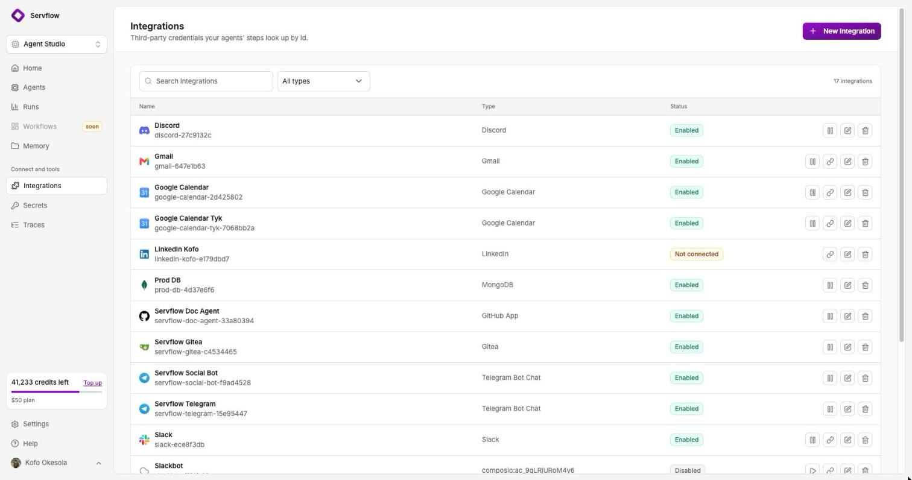
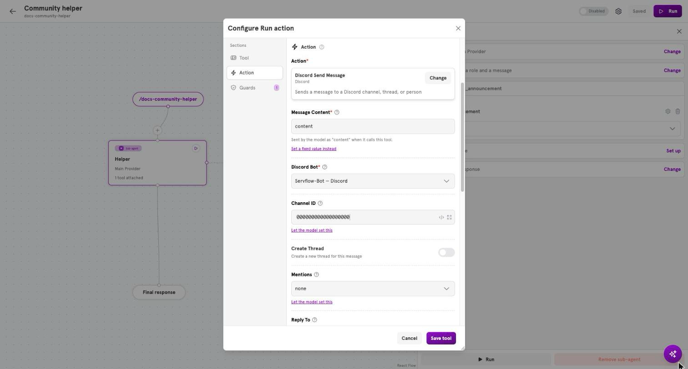

An integration is your connection to one outside service: a Discord bot, a Slack workspace, your Gmail account, a GitHub App, a database. It holds what Servflow needs to reach that service as you. You set it up once, give it a name, and choose it by that name wherever an agent needs it. To add one, see [Add an integration](/guides/add-an-integration). The apps Servflow connects to are listed in the [integrations directory](https://servflow.io/integrations); the built-in types are in [Available integrations](/references/integrations).

<Frame>
  
</Frame>

## Why an integration is separate from the agent

The details are sensitive, so they are entered once and not copied into every agent. And several agents can use the same integration, so replacing a token is one change, not one change per agent.

An integration is also either enabled or disabled. Saving a new integration from a form stores it disabled, and enabling it is what lets agents use it. An integration you set up by signing in, such as Slack or Gmail, is enabled when the sign-in returns. After you change an enabled integration, **Apply changes** makes the saved change the one agents use.

## Three places an integration is used

| Where | What it does there | Example |
|---|---|---|
| A trigger | Lets the agent receive messages or events from the service, and reply as that bot or app | A Discord bot or Slack bot trigger |
| A tool | Lets the agent act on the service when it decides to | A tool that sends a Discord message |
| A step | Lets the trigger look something up before the agent answers | A step that reads your database |

In each place, you pick the integration from a list by its name.

<Frame>
  
</Frame>

A tool that connects to an MCP server can also take its access token from an integration. See [Tools](/concepts/tools).

## One integration is both the key and the identity

When an agent replies through a Discord integration, it replies as that bot, with that bot's name and picture. The integration that lets messages in also decides who the agent is when it answers. The same holds for a Slack workspace, a GitHub App, and a Telegram bot: in Slack, the agent answers as the Servflow bot.

## Sharing an integration between agents

Two agents can use the same Discord bot. Each decides for itself whether a message is for it, using its own trigger settings. If both would answer the same message, both do.

## Integrations and secrets

Each sensitive field of an integration, such as a bot token, can point at a stored secret instead of holding the value. See [Secrets](/concepts/secrets), including what to do after you replace a secret that an integration uses.

## What kinds there are

The **New Integration** dialog shows every kind of integration your instance supports. Some are forms you fill in with a token or a connection string. Others are guided: for Slack you add the Servflow bot to a Slack workspace, and for apps such as Gmail, Google Calendar, and Notion you sign in to your account. The [Available integrations](/references/integrations) has a section for each, with its fields and what uses it.

## Integrations in the dashboard

**Integrations**, in the sidebar under **Connect and tools**, lists your integrations with their status. Click **New Integration**, choose a kind, and give it a **Name**. Servflow also gives it an internal id, which configs keep using even if you rename it later.

The status is one of these:

- **Enabled** means agents can use the integration. **Enabled · changes not applied** means a saved change is waiting for **Apply changes**.
- **Disabled** means it is stored, but no agent can use it until you click **Enable integration**.
- **Not connected** means a sign-in created the integration but did not finish. Use the row's **Connect integration** action to sign in again.

## When a change takes effect

Editing an integration only updates what is stored. An enabled integration keeps using its previous settings until you click **Apply changes**, or the server restarts.

An agent that stays connected through an integration, such as a Discord bot, keeps using the old settings until you enable the agent again.

## Related

<CardGroup cols={2}>

<Card title="Add an integration" icon="puzzle-piece" href="/guides/add-an-integration">
  Set one up and use it in a trigger.
</Card>

<Card title="Available integrations" icon="puzzle-piece" href="/references/integrations">
  Every integration type and its fields.
</Card>

<Card title="Secrets" icon="key" href="/concepts/secrets">
  Where an integration's tokens are kept.
</Card>

<Card title="Connect an agent to Discord" icon="discord" href="/guides/connect-an-agent-to-discord">
  An integration used by a trigger, step by step.
</Card>

</CardGroup>
