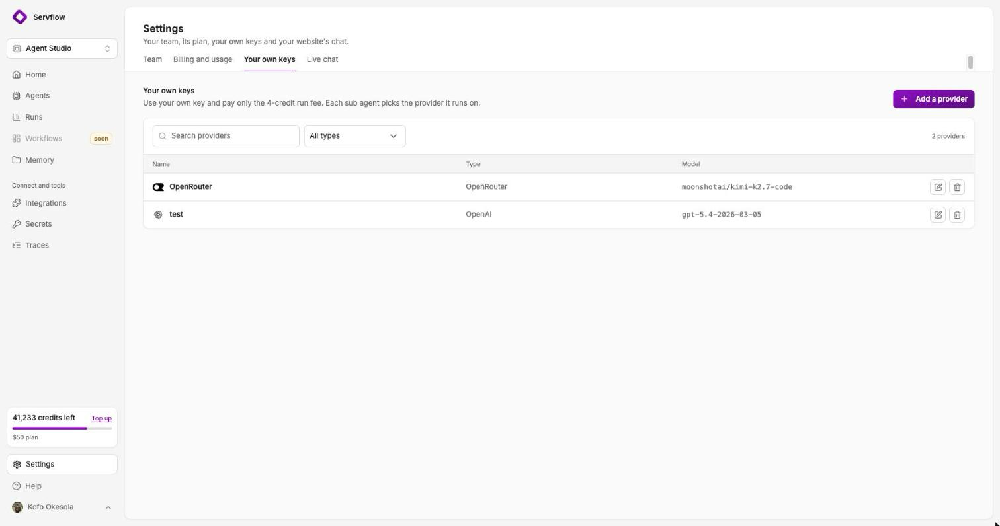
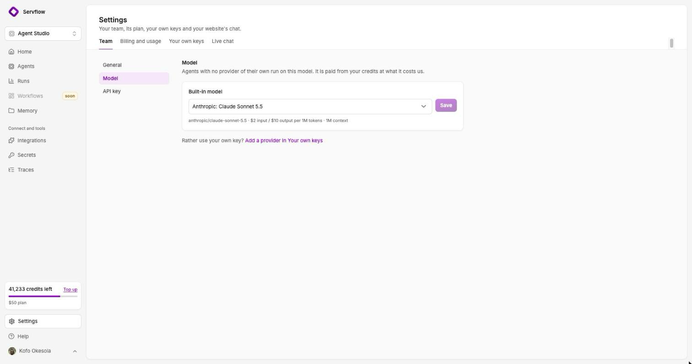

A provider is your account with a company that runs AI models, such as OpenAI or Anthropic, together with the model you want to use. On a self-hosted instance, every sub agent needs a provider to run. On Servflow Cloud, a sub agent with no provider uses your team's [built-in model](#built-in-model-on-servflow-cloud) instead. This page explains how providers work. To add one, see [Manage LLM providers](/guides/manage-llm-providers).

<Frame>
  
</Frame>

## Your account, not ours

A provider uses your own key. The model company bills you for the AI your agents use through it, including test runs from the agent's page. On Servflow Cloud, a run on your own key still costs the 4-credit run fee, and no credits for the AI.

Servflow can talk to five kinds of provider: Claude, OpenAI, OpenRouter, LiteLLM, and Qwen. OpenRouter and LiteLLM are services that give access to many companies' models through one account.

## Built-in model on Servflow Cloud

Servflow Cloud includes a model, so a new agent runs without an API key. A sub agent with no provider chosen calls your team's built-in model through OpenRouter, and the run is paid from your team's credits: the AI at cost plus the 4-credit run fee. A new team's built-in model is Claude Sonnet 5.5 (`anthropic/claude-sonnet-5.5`), and you can [change it](#choose-the-built-in-model).

The built-in model is not one of your providers. It does not appear in **Your own keys**. It is what a sub agent uses when its **Provider** setting is **No provider selected**; when you save, the agent stores it as the provider `native`. A self-hosted instance has no built-in model, so there every sub agent must have a provider.

### Choose the built-in model

The built-in model belongs to your team, so every sub agent with no provider uses the same one. Anyone on your team can change it.

To change the built-in model, follow these steps:

1. In the sidebar, click **Settings**, then click the **Team** tab.
2. Under **Model**, in **Built-in model**, search for a model by name and choose it. The list holds every model on OpenRouter that can call tools, since agents act through their tools.
3. Click **Save**.

<Frame>
  
</Frame>

Runs that start after you save use the new model. A run already in progress finishes on the model it started with.

Models cost very different amounts. The list shows each model's price for a million input and output tokens. A cheaper model makes the same credits last longer, and a more expensive one spends them faster.

### Credits from your plan

Every team starts on the Free plan with 4,000 credits, given once. They never expire. The Paid, Starter, and Pro plans add 10,000, 26,000, and 55,000 credits each time the plan renews, which is when its invoice is paid, not on the first of the month. Plan credits you have not used expire at the next renewal. For what each plan costs, see [Plans and credits](/concepts/plans-and-credits).

### Top up

Any team can buy more credits, on any plan, Free included. In the sidebar, click **Settings**, then click the **Billing and usage** tab. On the **Credits** card, click **Top up**, choose an amount from 5,000 to 500,000 credits in thousands, and pay on Stripe. A credit is $0.001, so 5,000 credits cost $5, and there is no fee. The credits are added as soon as the payment clears.

Credits you top up never expire, and they stay when you change or cancel your plan. Runs spend plan credits before topped-up ones. See [Top up credits](/guides/top-up-credits).

### When the credits run out

When your team runs out of credits, every agent's runs are refused, the scheduled ones included. That covers agents on your own keys too, because each run still costs the run fee. Runs start again as soon as you top up, your plan renews, or you move to a plan with credits.

### Use your own key instead

To use your own key for a sub agent, add a provider in **Settings > Your own keys** and choose it under the sub agent's **Provider** setting. That sub agent then calls the model through your account, and each run costs only the 4-credit run fee. To go back to the built-in model, choose **No provider selected**. See [Manage LLM providers](/guides/manage-llm-providers).

## One provider, many sub agents

You set a provider up once. Each sub agent then chooses one. Most instances need only one or two providers.

## The model belongs to the provider

A sub agent's panel has a **Provider** setting and no model setting, because the model is part of the provider.

To run a quick, low-cost model for a simple stage and a stronger one for a hard stage, add two providers with the same key and different models. Then choose between them in each sub agent:

| Sub agent | Job | Provider |
|---|---|---|
| Sort the request | Decide what kind of question this is | `OpenAI small` |
| Write the answer | Compose the reply | `OpenAI large` |

## Changes apply from the next run

When you change a provider's key or model, every agent that uses it follows on its next run. You do not reopen or save the agents.

## If a provider is deleted

Servflow lets you delete a provider that agents still use. Those agents then fail when they next run. Point them at another provider first.

## Keeping the key safe

The key is kept with the provider. It is hidden as you type it and is left out of lists. It is not a stored [secret](/concepts/secrets), so you will not find it on the **Secrets** page.

If you run your own instance, you can have Servflow encrypt stored keys. See the [Configuration reference](/references/configuration).

## Providers in the dashboard

On Servflow Cloud, **Settings > Your own keys** lists your providers, and **Add a provider** adds one. On a self-hosted instance, the list is **Providers**, in the sidebar under **Connect and tools**. To choose a provider for a sub agent, open the sub agent and pick it under **Provider**.

## Related

<CardGroup cols={2}>

<Card title="Manage LLM providers" icon="cloud" href="/guides/manage-llm-providers">
  Add, change, and delete a provider.
</Card>

<Card title="Available providers" icon="cloud" href="/references/providers">
  Every provider type and its fields.
</Card>

<Card title="Agents" icon="robot" href="/concepts/agents">
  Sub agents, and what each one needs to run.
</Card>

<Card title="Secrets" icon="key" href="/concepts/secrets">
  Where tokens for integrations are kept.
</Card>

</CardGroup>
