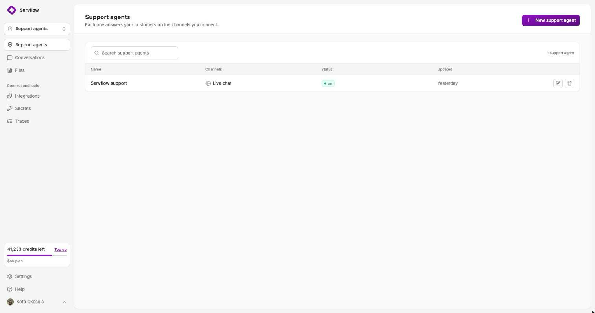

A support agent answers your customers on the channels they already write to: your support email address, your Discord server, or the live chat on your website. It answers from your instructions and from files your team added. Before any reply reaches a customer, it is checked against rules you wrote. When the support agent should not answer, it hands the conversation to a person on your team. This page explains how a support agent is put together and what happens to one message, for anyone deciding whether to set one up.

Support agents are part of the hosted Servflow dashboard at [dash.servflow.io](https://dash.servflow.io). On the Free plan, your team can have one support agent, and it answers on live chat only; email, Discord and files are on paid plans. A self-hosted instance does not have support agents.

<Frame>
  
</Frame>

## The parts of a support agent

A support agent is one page of settings in the dashboard. Each part answers one question:

- **Channels: where do customers write?** A channel is an email account (Gmail or Outlook), your team's Discord bot, or your website's live chat. The support agent reads each new message on its channels and replies on the same channel. See [Connect a support channel](/guides/connect-a-support-channel) and [Add live chat to your website](/guides/add-live-chat-to-your-website).
- **Instructions: what should it know and do?** Plain-language text that tells it who your business is, how to sound, and when to hand off.
- **Files: what does it answer from?** Files your team added on the **Files** page, such as a returns policy or a price list. Every support agent on the team uses the same files. A file with a policy label loads only when a customer's message matches the label. See [Files and policy labels](/concepts/files-and-policy-labels).
- **Tools: what can it look up or do?** Optional actions in your connected apps, or the tools of an MCP server.
- **Handoff: who does it tell when a customer needs a person?** An action in one of your connected apps, with a description of when to use it. See [Set up a handoff](/guides/set-up-a-handoff).
- **Guardrails: what must every reply do?** One to five rules in plain words. Every reply is checked against them before it is sent. See [Guardrails on support replies](/concepts/support-guardrails).
- **Fallback message: what does a customer get instead?** A short, safe message sent when a reply is blocked or the support agent can't answer.

Everything a support agent did with one customer is a **conversation**. One email thread, one Discord channel or direct message, or one chat on your website is one conversation.

## How one reply travels

1. **A customer writes.** A new email arrives in a connected inbox, someone posts in a Discord channel the support agent answers in, or a customer sends a message in your website's live chat. Mail the inbox sent itself, and automatic mail such as out-of-office replies, bounces and mailing lists, is ignored.
2. **The files load.** Every file with no policy label loads, plus the files whose policy labels match this message or an earlier one in the conversation.
3. **The support agent drafts a reply.** It reads the conversation so far, its instructions, the loaded files, and anything its tools return. It may run a tool or two along the way. On live chat it can also show products as cards under the reply.
4. **The guardrails check the draft.** Every guardrail checks it at the same time, reading the customer's latest message, the tools the support agent used, the loaded files, and the draft. Only a clear pass from every guardrail lets the reply out.
5. **The reply is sent, or the fallback message is.** A reply that passes goes back on the channel it came from: in the same email thread, in the same Discord channel, or in the chat on your website. If a guardrail blocks the reply, the support agent writes it once more with the guardrails' reasons, and the new reply is checked again. If that one is blocked too, or a check can't run, the customer gets the fallback message instead, and the conversation is marked **blocked**. The fallback message is also sent when the support agent's run fails, for example when the loaded files go over the 200,000-character limit.
6. **A handoff ends the support agent's part.** If the support agent decides a person should take over, it runs the handoff action, and the conversation is marked **handed off**. It never answers that conversation again, even when the customer writes back.

You read all of this afterwards on the **Conversations** page: every message, each reply the guardrails withheld with the fallback that went out instead, each handoff, and a trace of every run. See [Read support conversations](/guides/read-support-conversations).

## Cards on live chat

On live chat, a reply can show products as cards under it. A card has a title, a line such as the price, a picture and a link, with **View** and **Ask about it** buttons for the customer. Two or more cards show as a row the customer scrolls. A support agent with the live chat channel can always show cards; its instructions say when. The support agent is told to copy each card's values exactly from a tool result or your files, and the guardrails read the cards with the reply. A blocked reply sends no cards. On email and Discord, the support agent writes the products in its reply instead. See [Show products as cards in live chat](/guides/show-cards-in-live-chat).

## Why every reply is checked

A support agent writes to people outside your team, in your name. A wrong answer about a refund or a delivery date costs more than a slow one. So nothing the support agent writes reaches a customer without passing the guardrails, and when the check is unsure or can't run, the customer gets your fallback message rather than an unchecked reply.

For the same reason, a tool can't send through the support agent's own channels. A tool that replied to the customer directly would skip the check.

## On and off

A new support agent is off. It answers no one until you enable it, and then it answers on every channel you added. Your website's chat shows only while the support agent chosen to answer it is on. Saving a change to a support agent that is on does not change what customers get. Customers get the version you last enabled, guardrails and fallback message included, until you apply your saved changes. Files are the exception: a file you add or remove takes effect from the next customer message. This lets you edit without a half-finished change reaching a customer.

## How a support agent differs from an agent

Servflow has two products in one dashboard, and a switch at the top of the sidebar moves between them: **Agents** and **Support agents**.

| | Agent | Support agent |
|---|---|---|
| Who it works for | Your team | Your customers |
| How it starts | A schedule, a webhook, or a message, set up in the agent editor | A customer writing on one of its channels |
| How you set it up | The agent editor, where you build its parts on a canvas | One page of settings |
| What it sends | Whatever its tools do | Replies that pass the guardrails, or the fallback message |
| Where it runs | The hosted dashboard or a self-hosted instance | The hosted dashboard only |

Integrations, secrets and traces are shared by both products. An email account or Discord bot you connect once can serve either. Files and the live chat belong to support agents only.

## Next steps

<CardGroup cols={2}>

<Card title="Create a support agent" icon="headset" href="/guides/create-a-support-agent">
  Set one up, from a channel to the first customer answered.
</Card>

<Card title="Files and policy labels" icon="folder-open" href="/concepts/files-and-policy-labels">
  Which files load for a customer's message, and why.
</Card>

<Card title="Add live chat to your website" icon="comments" href="/guides/add-live-chat-to-your-website">
  Answer customers in a chat on your own site.
</Card>

<Card title="Read support conversations" icon="comments" href="/guides/read-support-conversations">
  See what it said, what it withheld, and why.
</Card>

</CardGroup>
