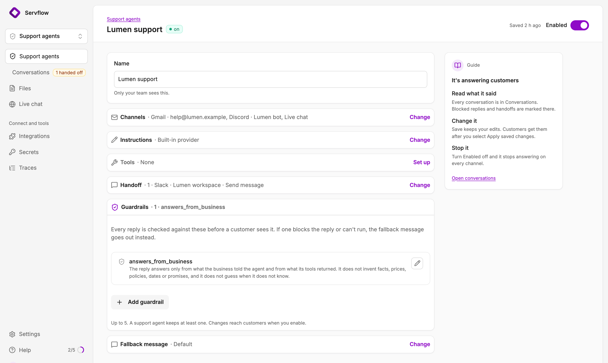

A guardrail is a rule that every reply of a support agent must meet before a customer sees it. This page explains how the check runs, what happens when a reply does not pass, and how to write rules that catch what matters. It is for anyone setting up or reviewing a support agent. For what a support agent is, see [Support agents](/concepts/support-agents).

## What a guardrail is

A guardrail is a name and one rule in plain words. The rule answers the question **What must every reply do?**, in up to 2,000 characters. The name is how the trace and the conversation refer to the guardrail when it blocks a reply, for example `stays_on_topic`.

A support agent has between one and five guardrails. You add, change and remove them in the **Guardrails** section of the support agent's page; a support agent always keeps at least one.

<Frame>
  
</Frame>

## How a check runs

The support agent drafts a reply first. Before the reply leaves, every guardrail checks it at the same time, each in a separate model call, outside the conversation with the customer. The customer waits for the slowest check. Each check reads four things:

- the customer's latest message
- the tools the support agent used for this reply, and what each returned
- the files loaded for this message: every file with no policy label, and the files whose policy labels the conversation loaded
- the draft reply

Each check answers either allow or block, with a one-sentence reason. Only a clear allow passes. Every guardrail is asked, even when another one blocks, so the reasons name every rule the reply broke. The reply goes out only when every guardrail allows it.

Because the check reads what the tools returned and the loaded files, a reply can state a fact that came from a tool, such as an order's status, or from one of your files, such as your returns window, and still pass a rule like "answers only from what the business told it". See [Files and policy labels](/concepts/files-and-policy-labels).

The check is separate from the support agent on purpose. The support agent is talking to the customer, and a customer can try to talk it into saying something it should not. The check never talks to the customer. It is told to read the customer's message, the tool results and the reply as data to judge, never as instructions, and to judge the reply against your rule alone.

The check does not see the support agent's instructions. Write each rule so it can be judged from the customer's message, the tool results, the loaded files and the reply. A fact that a reply should be allowed to state belongs in a file, where the check can see it.

## When a guardrail blocks a reply

When one or more guardrails block a reply, the support agent gets one more try. It is told that its reply was not sent, with the name of each guardrail that blocked it and the reason, and it writes a new reply to the customer's message. The customer never sees the blocked reply. The new reply goes through every guardrail again:

- If the new reply passes, it is sent like any other reply, and the conversation is not marked **blocked**.
- If the new reply is blocked too, it is withheld, and the customer gets your fallback message.

There is no second try when no guardrail blocked the reply but the check could not finish, or when the support agent wrote no reply. The fallback message goes out straight away. Both tries show in the run's trace.

## What blocked means

A reply is withheld, and the customer gets your fallback message instead, when:

- the second reply is blocked too
- a check fails or can't reach a model
- the checks of one reply take longer than 30 seconds
- the support agent wrote no reply at all

The conversation is then marked **blocked**. On the conversation's page, the withheld reply appears struck through and labelled "not sent", with the guardrail and its reason, and below it the fallback message that went out. See [Read support conversations](/guides/read-support-conversations).

A blocked reply does not hand the conversation off. The conversation stays open, and the support agent answers the customer's next message as usual. If a blocked reply should bring in a person, say so in the handoff's description, or read the blocked conversations and reply yourself.

## The fallback message

The fallback message is what a customer gets instead of a reply that was withheld. It is also sent when the support agent's run fails, for example when the files loaded for a message go over the 200,000-character limit. A failed run is not marked **blocked**; find it under **Failed** on the **Traces** page. It can be up to 1,000 characters. If you leave it empty, customers get:

```
Thanks for your message. A member of our team will reply soon.
```

The fallback message is not checked by the guardrails, so write something that is safe to send to anyone, about anything. Don't promise a time you can't keep.

## The default guardrail

A new support agent starts with one guardrail, `answers_from_business`, so that no reply goes out unchecked:

```
The reply answers only from what the business told the agent and from what its tools returned. It does not invent facts, prices, policies, dates or promises, and it does not guess when it does not know.
```

You can change it or replace it once the support agent is saved.

## Which version is checked

Replies are checked against the guardrails and the fallback message of the version you last enabled. A saved change to them reaches customers only after **Apply saved changes**. This keeps a half-written rule from blocking real replies while you edit.

## Writing a good rule

A good rule describes one thing that a reply can be judged on from the reply itself, the customer's message, what the tools returned, and the loaded files. Write it as what the reply does, not what the support agent should think. Some examples:

- **Stays on topic.** `The reply is about our shop, its products, orders or services, and nothing else.`
- **No commitments.** `The reply does not promise a refund, a discount, a replacement or a delivery date unless a tool returned it or a file states it.`
- **No personal data.** `The reply contains no email address, phone number or street address except ones the customer wrote in their message.`

Some things to keep in mind:

- **One concern per guardrail.** A rule that mixes three concerns is harder for the check to apply, and its reason is harder for you to read.
- **Each guardrail is a model call.** The checks run at the same time, so the reply waits for the slowest one, and more guardrails mean more chances that one blocks it. Use the few that matter.
- **Read what gets blocked.** In the first days, open the blocked conversations. A rule that blocks good replies needs rewording; a reply that should have been blocked needs a rule.

## Guardrails and tool guards

Servflow has two kinds of safety rule, and they check different things at different times.

| | Guardrail | Tool guard |
|---|---|---|
| Used on | A support agent | An agent's tool |
| Checks | The reply, after it is written and before it is sent | Who sent the message, before a tool runs |
| Written as | A rule in plain words, judged by a model | A condition that comes out true or false |
| When it says no | The support agent writes the reply once more, and the fallback message is sent if that is blocked too | The tool does not run, and the agent carries on |

For guards on an agent's tools, see [Guard rails](/concepts/guard-rails).

## Next steps

<CardGroup cols={2}>

<Card title="Read support conversations" icon="comments" href="/guides/read-support-conversations">
  Find blocked replies and see which guardrail stopped them.
</Card>

<Card title="Create a support agent" icon="headset" href="/guides/create-a-support-agent">
  Set one up and enable it.
</Card>

<Card title="Set up a handoff" icon="hand" href="/guides/set-up-a-handoff">
  Let the support agent pass a customer to a person.
</Card>

<Card title="Guard rails" icon="shield-halved" href="/concepts/guard-rails">
  Limit what an agent's tools may do.
</Card>

</CardGroup>
