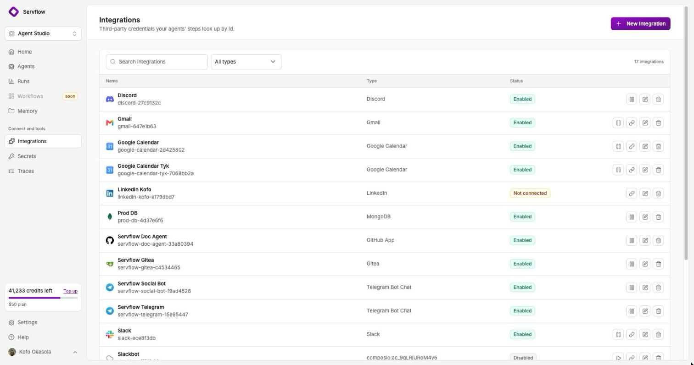
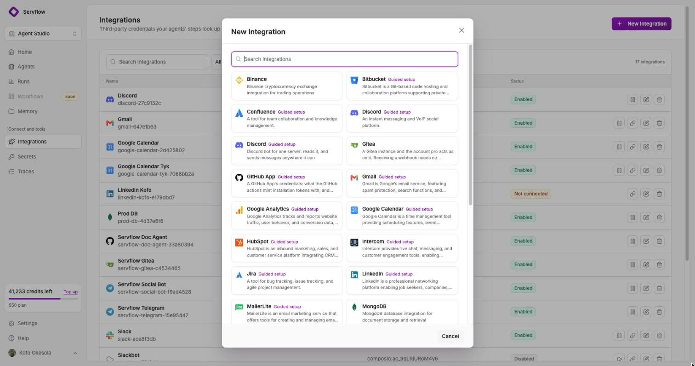
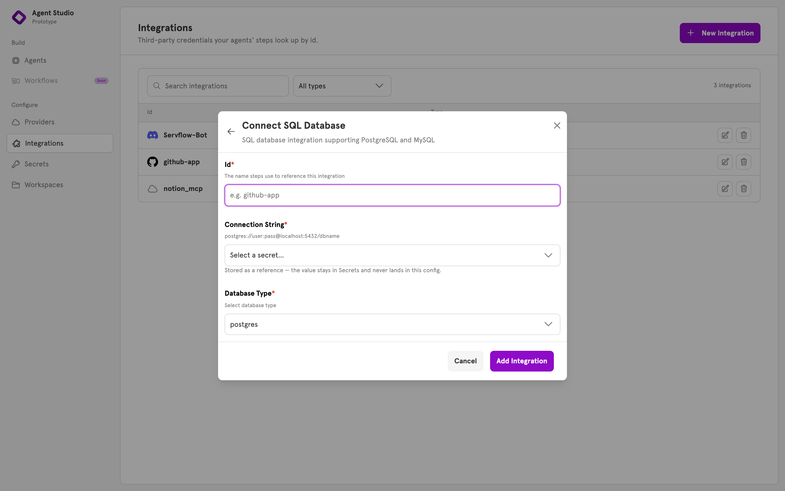
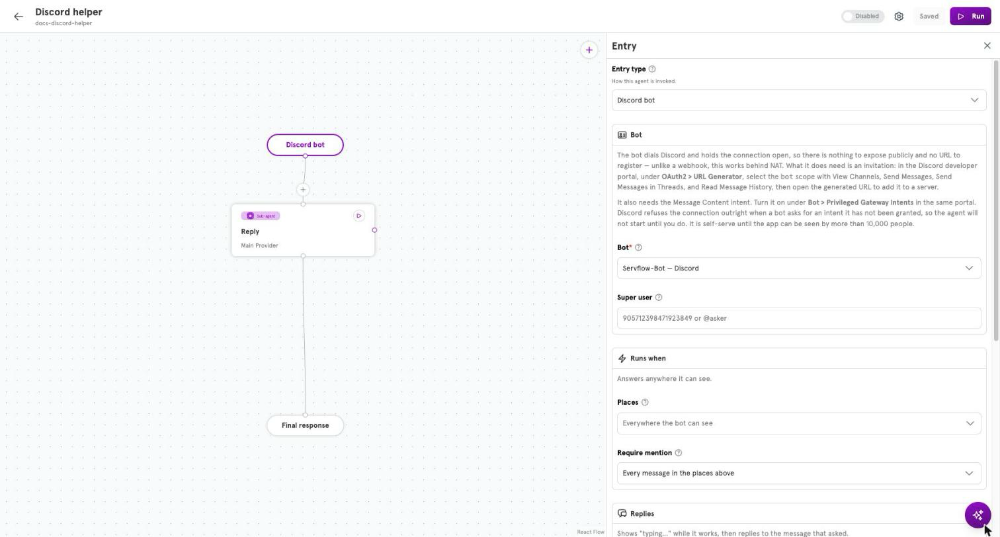
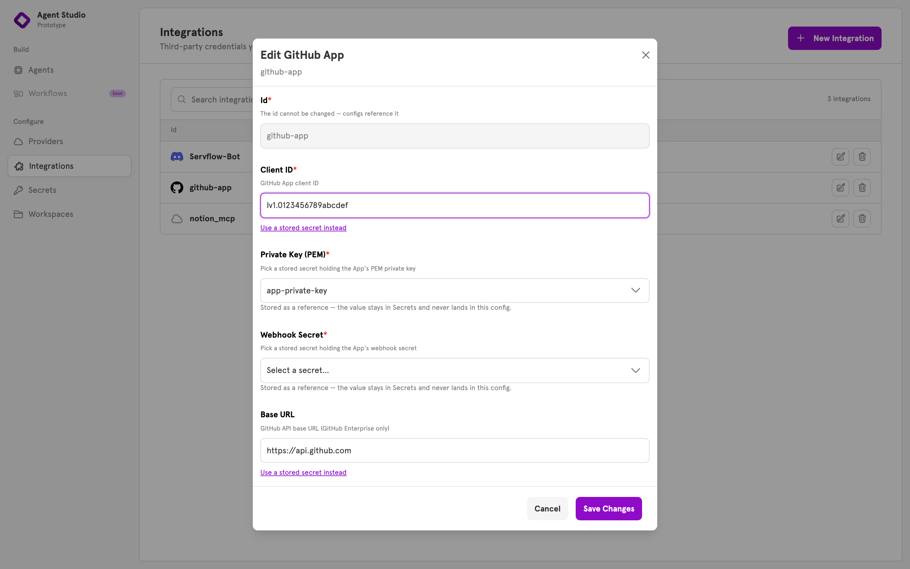

This guide adds an integration in the dashboard: a stored credential, such as a database connection string or a bot token, that agents can use wherever they need that service. Use it when an action, a trigger, or a tool asks for an integration you do not have yet.

## Before you begin

- A Servflow account at [dash.servflow.io](https://dash.servflow.io), or a [self-hosted instance](/installation).
- The credential for the service you are connecting. Each type's fields are listed in the [Available integrations](/references/integrations).

## Add the integration

<Steps>

<Step title="Open Integrations">
In the sidebar under **Connect and tools**, click **Integrations**. The page lists every integration by name, type, and status. The status is **Enabled**, **Disabled**, or **Not connected** when a sign-in was never finished.

<Frame>
  
</Frame>
</Step>

<Step title="Choose a type">
Click **New Integration**, then search for the type or scroll to it, and click it. Discord, GitHub App, Notion, Slack, and the apps you sign in to, such as Gmail and Google Calendar, are marked **Guided setup** and open a flow of their own. Every other type opens a form with one input per field.

<Frame>
  
</Frame>

For a guided setup, see [Connect an agent to Discord](/guides/connect-an-agent-to-discord).

The guided setups that sign you in work the same way. You enter a **Name**, click the button, and sign in on the app's own page:

- For an app such as Gmail, click **Connect to** and the app's name, then sign in and approve the connection.
- For Slack, click **Add to Slack**, then pick a Slack workspace and add the Servflow bot to it. See [Connect an agent to Slack](/guides/connect-an-agent-to-slack).
- For Notion, sign in to Notion and approve the connection.

When you come back, Servflow creates the integration and enables it. Each sign-in is its own integration, so you can add more than one account of the same app by giving each one a different name.
</Step>

<Step title="Enter a name and the fields">
Enter a **Name**, for example `Orders database`. This is what you will see and pick everywhere else in the dashboard, and you can change it later if you need to.

Fill in the fields. A required field is marked with an asterisk. A select field, such as SQL Database's **Database Type**, lists its allowed values.

<Frame>
  
</Frame>
</Step>

<Step title="Keep the credential in Secrets">
A password field, such as **Connection String** or **Bot Token**, opens a secret picker. Choose a stored secret, or choose **+ New secret…** to store the value now. The form then keeps a reference, and the value stays in Secrets.

To paste the value into the integration instead, choose **Enter a value directly…**. The form warns that the value is stored in the integration's config as typed. Any other field can hold a reference too: click **Use a stored secret instead** under it. See [Secrets](/concepts/secrets).
</Step>

<Step title="Add it">
Click **Add Integration**. The dialog closes, and the integration appears in the list with its type and the status **Disabled**. A new integration from a form starts disabled: open the row's actions and click **Enable integration** before an agent can use it.

A guided setup that signs you in creates the integration before the sign-in finishes. If you leave the sign-in, the row shows **Not connected**. Use the row's **Connect integration** action to sign in again.
</Step>

</Steps>

## Use the integration from an agent

Any field that takes an integration lists the stored ones by name, filtered to the types that field accepts. In an action step, this is the step's integration field. In a trigger, it is a field such as the Discord trigger's **Bot**. Choose the integration, or choose **+ New integration…** to add one without leaving the agent.

<Frame>
  
</Frame>

## Edit or delete an integration

On the Integrations page, the pencil on a row opens the same form. Change the **Name** or the fields and click **Save Changes**. A password field that holds a literal value opens blank. Leave it blank to keep the stored value, or enter a replacement. Saving an enabled integration does not change what agents use yet: its status reads **Enabled · changes not applied** until you click **Apply changes** in the row's actions.

The row's actions depend on its status:

| Action | When it shows | What it does |
|---|---|---|
| **Connect integration** | **Not connected** | Starts the sign-in again. |
| **Enable integration** | **Disabled** | Builds the integration so agents can use it. If it can't be built, a message says why. |
| **Apply changes** | **Enabled**, with saved changes | Makes the saved changes the ones agents use. |
| **Disable integration** | **Enabled** | Stops agents from using it. |
| **Reconnect account** | An app you signed in to | Signs in again, for example with another account. |
| **Reinstall in Slack** | A Slack integration | Adds the Servflow bot to the Slack workspace again. |

<Frame>
  
</Frame>

The trash icon deletes the integration. A step or trigger that references the deleted integration stops working until it is pointed at another one.

## Verify

The integration appears in the list on the Integrations page. Once you enable it, its status is **Enabled**. From the terminal, it also appears in:

```bash
servflowai resource integration list
```

The list shows ids and types only. Config is never printed.

## Related

<CardGroup cols={2}>

<Card title="Available integrations" icon="puzzle-piece" href="/references/integrations">
  Every type, its fields, and what uses it.
</Card>

<Card title="Secrets" icon="key" href="/concepts/secrets">
  Store a credential once and reference it from an integration.
</Card>

<Card title="Connect an agent to Discord" icon="discord" href="/guides/connect-an-agent-to-discord">
  A guided setup, end to end.
</Card>

<Card title="Create an agent" icon="robot" href="/guides/create-an-agent">
  Build the agent that uses the integration.
</Card>

</CardGroup>
