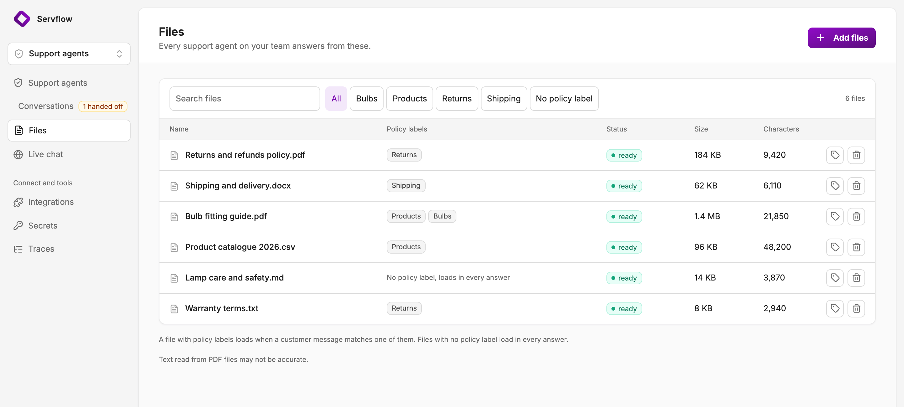
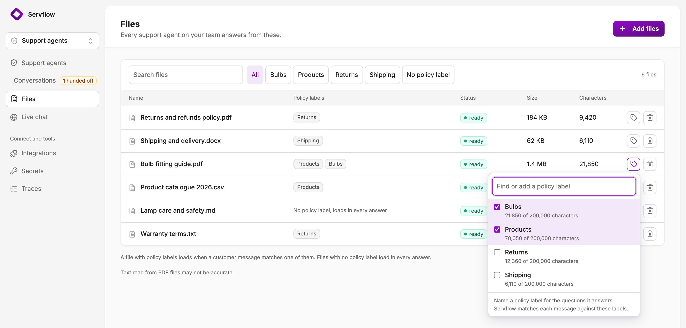

This guide adds files on the **Files** page, gives a file policy labels, and removes files you no longer want answered from. Files are your team's: every support agent on the team answers from the same files. For how a file reaches an answer and when to label one, see [Files and policy labels](/concepts/files-and-policy-labels).

## Before you begin

- A Servflow team at [dash.servflow.io](https://dash.servflow.io) on a paid plan. On the Free plan, the **Files** page says "Files are on paid plans." with **See plans**, and has no **Add files** button. Until your team is on a paid plan, its support agent answers from its instructions.
- The files your customers' answers come from, such as your returns policy, delivery prices or opening hours, in one of the file types below.

## File types and sizes

| Type | Extensions |
|---|---|
| PDF | `.pdf` |
| Word | `.docx` |
| Text | `.txt` |
| Markdown | `.md` |
| CSV | `.csv` |
| HTML | `.html`, `.htm` |

Each file can be up to 25 MB. Split a larger file into parts and add each part.

Servflow reads the text out of each file, and the support agent answers from that text. Text read from a PDF may not be accurate, for example where the PDF uses an unusual font. If a PDF matters, check its text after it is read, or add the same content as a Word or text file.

## Add files

<Steps>

<Step title="Open Files">
With **Support agents** chosen in the product menu, click **Files** in the sidebar. The **Files** page lists every file your team added, with the columns **Name**, **Policy labels**, **Status**, **Size** and **Characters**.

<Frame>
  
</Frame>
</Step>

<Step title="Click Add files">
Click **Add files** and choose one or more files. Each file is sent in turn, with a progress bar, and then shows **reading** while Servflow reads its text. You can leave the page; reading carries on.

When a file is read, its status changes to **ready** and **Characters** shows how much text it holds. The support agents answer from it from the next customer message.
</Step>

<Step title="Check the text">
Optional: click a ready file's name to see the text Servflow read from it. This is the text your support agents answer from. A PDF's pages are shown one after another.
</Step>

<Step title="Add a policy label">
Optional: to load a file only for the questions it answers, give it a policy label. On the file's row, click the tag icon, **Choose policy labels**. In **Find or add a policy label**, type a name for the kind of question, such as `returns`, and press Enter, or click **Add policy label** with that name. To reuse a label another file has, tick it in the list.

Each label in the list shows how many characters of files it loads, out of 200,000. Each change saves at once. To remove a label from the file, untick it.

A label is 1 to 60 characters, and a file can have up to 10.

<Frame>
  
</Frame>
</Step>

</Steps>

A file with no policy label shows "No policy label, loads in every answer" in its row. Leave a file without a label when most customers need it, such as your opening hours.

## Find files by policy label

Once files have labels, the chips above the table filter the list: **All**, one chip for each label, and **No policy label**. To find a file by name, type in **Search files**.

## Remove a file

On the file's row, click the bin icon, **Delete file**. The dialog asks you to confirm and says the file's text goes too. Click **Delete file**. Your support agents stop answering from it from the next customer message. This can't be undone; to bring the file back, add it again.

A file that is still **reading** has no delete button until reading is done.

## When a file can't be added or read

A file that goes wrong stays in the table with a sentence under its name. Click **Dismiss** to clear the row.

- **not added** means the file was refused before it was read. The sentence says why, for example "This file is over 25 MB. Split it, then add the parts." or that Servflow can't read the file type. Fix the file, then add it again.
- **failed** means the file was received but its text couldn't be read: "Servflow couldn't read this file. Check it, then add it again." Check that the file opens on your computer, then add it again, or save it as another file type and add that.

If reading takes much longer than usual, the row says "This is taking longer than usual."

## Next steps

<CardGroup cols={2}>

<Card title="Files and policy labels" icon="folder-open" href="/concepts/files-and-policy-labels">
  How a file reaches an answer, and when to label one.
</Card>

<Card title="Read support conversations" icon="comments" href="/guides/read-support-conversations">
  See which policy labels each conversation loaded.
</Card>

<Card title="Create a support agent" icon="headset" href="/guides/create-a-support-agent">
  Set up a support agent that answers from your files.
</Card>

<Card title="Guardrails on support replies" icon="shield-check" href="/concepts/support-guardrails">
  How the check uses your files.
</Card>

</CardGroup>
