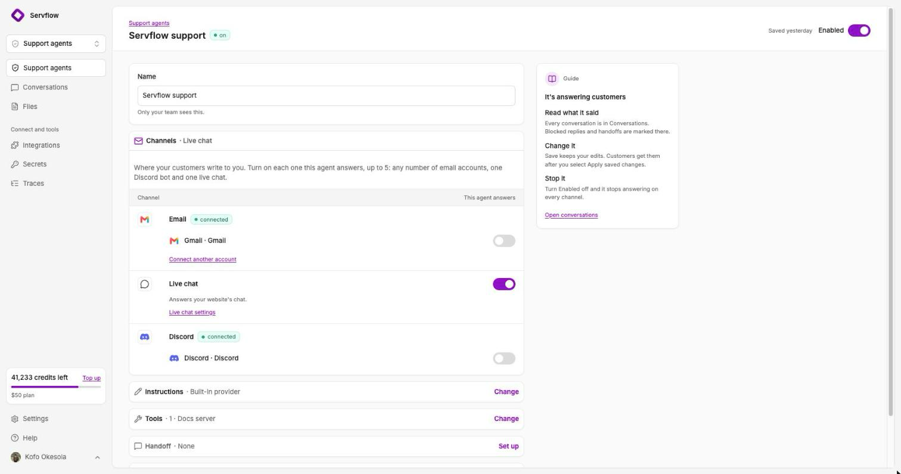
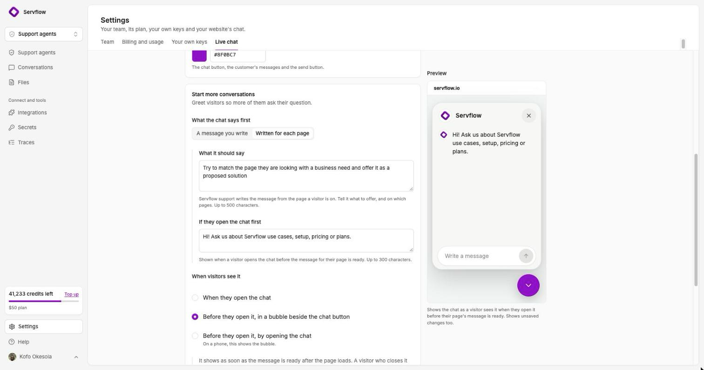
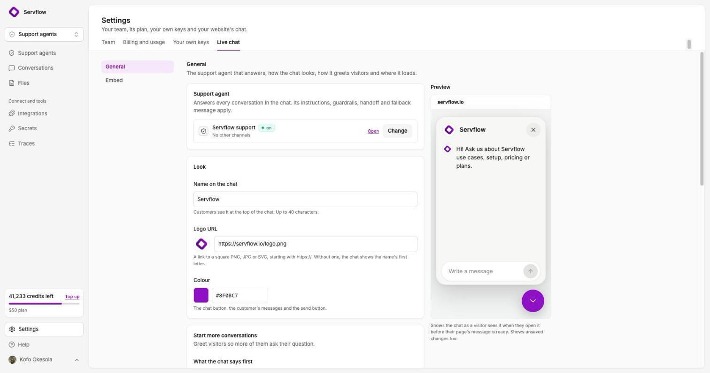
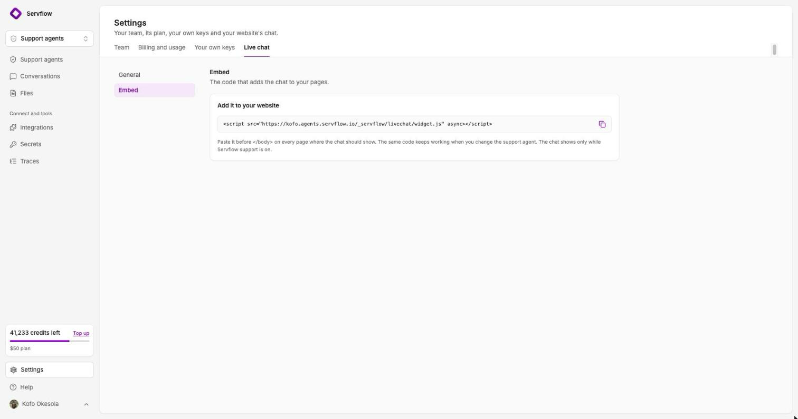
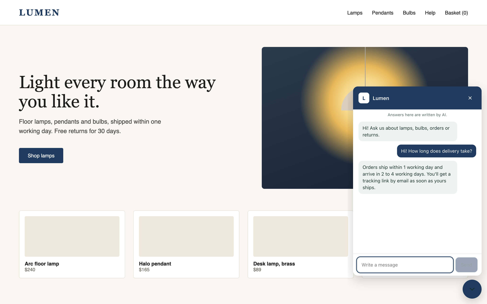

This guide puts a chat on your website that your support agent answers. Your customers open it from a button in the corner of the page, write a question, and get a reply that has passed the guardrails. Your team has one live chat, and one support agent answers it at a time.

## Before you begin

- A support agent. To create one, see [Create a support agent](/guides/create-a-support-agent). Live chat needs no email account or bot, and it is on every plan, Free included.
- Access to your website's HTML, or to the place in your site builder where you add a script to every page.
- A website served over `https`. The chat loads only on secure pages, apart from `localhost` while you test.

## Add the chat

<Steps>

<Step title="Turn on live chat for the support agent">
Open the support agent from the **Support agents** page and open **Channels**. On the **Live chat** row, turn on **Answer on Live chat**. The line under it says whether this support agent answers your website's chat, with a **Live chat settings** link.

A support agent can have one live chat channel. If the switch can't be turned on, the support agent already has five channels.

<Frame>
  
</Frame>
</Step>

<Step title="Save and turn the support agent on">
Click **Save**. If the support agent is off, click **Enable**. If it is already on, click **Apply saved changes**. The chat shows on your website only while the support agent that answers it is on.
</Step>

<Step title="Open the live chat settings">
Click **Live chat settings** under the **Live chat** row, or click **Settings** at the foot of the sidebar and choose **Live chat**. The page has two sections: **General**, with the settings and a preview of the chat beside them, and **Embed**, with the code for your website. The preview shows unsaved changes too, but you can't send messages from it.
</Step>

<Step title="Choose the support agent">
In the **Support agent** card, open **Choose a support agent** and pick one. The list shows only support agents that have the live chat channel, each with its status. The chosen support agent's instructions, guardrails, handoff and fallback message apply to every conversation in the chat.

If the support agent you chose is off, a note under it says the chat doesn't show on your websites until it is on.
</Step>

<Step title="Set how the chat looks">
In **Look**:

- **Name on the chat**: the name customers see at the top of the chat, usually your business name. Up to 40 characters.
- **Logo URL**: optional. A link to a square PNG, JPG or SVG that starts with `https://`. Without one, the chat shows the first letter of the name.
- **Colour**: the colour of the chat button, the customer's messages and the send button, as `#RRGGBB`. It starts as `#1F1F1F`.
</Step>

<Step title="Choose how the chat greets customers">
In **Start more conversations**, under **What the chat says first**, choose one:

- **A message you write**: write it in **The message**, up to 300 characters. It starts as `How can we help?`.
- **Written for each page**: the chosen support agent writes the first message from the page the customer is on. In **What it should say**, tell it what to offer and on which pages, up to 500 characters, for example `On bike pages, offer a free test ride.` In **If they open the chat first**, write the message a customer sees when they open the chat before their page's message is ready. This choice needs a support agent chosen for the chat.

Under **When visitors see it**, choose when the first message shows:

- **When they open the chat**.
- **Before they open it, in a bubble beside the chat button**.
- **Before they open it, by opening the chat**. On a phone, this shows the bubble instead.

With a message you write, **After** sets how long the page waits before the bubble or the chat opens: **At once**, or 5, 10, 30 or 60 seconds. A customer who closes it doesn't see it again in that browser until you change the message.

<Frame>
  
</Frame>
</Step>

<Step title="List your websites">
In **Websites**, type each site the chat should load on and click **Add**, for example `lumencycles.com`. Add from 1 to 10. The chat loads only on these sites, so list every host your pages use: `lumencycles.com` and `www.lumencycles.com` are two different websites. A link you paste is shortened to its host.

<Frame>
  
</Frame>
</Step>

<Step title="Save">
Click **Save** at the end of **General**. Until a support agent is chosen and the name and a website are filled in, a note says what is missing, and **Save** stays unavailable. If the save is refused, the reason appears above the cards and under the field it concerns.
</Step>

<Step title="Copy the code">
After you save, **Add it to your website** in **Embed** shows one line of code. Click the copy button beside it. The code looks like this, with your team's address in place of the example:

```html
<script src="https://<your-team>.<agents-host>/_servflow/livechat/widget.js" async></script>
```

<Frame>
  
</Frame>
</Step>

<Step title="Paste it on your website">
Paste the code just before `</body>` on every page where the chat should show. In a site builder, use the setting that adds custom code to the end of every page. You paste it once: the same code keeps working when you change the chat's look or the support agent that answers it.
</Step>

<Step title="Check it on your site">
Open one of your listed websites in a browser. A round chat button appears at the bottom right of the page. Open it, send a question, and wait for the reply. Then open **Conversations** in the dashboard: the conversation is listed, with the customer shown as **Live chat visitor**.

<Frame>
  
</Frame>
</Step>

</Steps>

## What your customer sees

- A round button at the bottom right of the page, in your colour. On a screen narrower than 480 pixels, the open chat fills the screen.
- If you chose a bubble, your first message beside the chat button before they open it. A close button hides it.
- A header with your logo, or the first letter of the name, and the name on the chat.
- Your first message, then a box that says **Write a message**, up to 2,000 characters, and **Send**.
- The reply, once it has passed the guardrails. Replies arrive whole, not word by word. If a reply is blocked, the customer gets the fallback message instead.
- Cards under a reply, when the support agent shows products. Each card has a picture, a title, a line such as the price, **View**, which opens the product's link, and **Ask about it**, which asks the support agent about that product. Two or more cards show as a row the customer scrolls. See [Show products as cards in live chat](/guides/show-cards-in-live-chat).
- Once they have written, the **Start a new chat** button in the header, which starts a new conversation.
- When this browser has more than one of their chats, the name in the header opens **Your chats on this browser**, to go back to an earlier chat.
- After a handoff, the message box is replaced by **Start a new chat**. The support agent doesn't answer the handed-off conversation again.
- On the Free plan, "Powered by Servflow" under the chat. Paid plans remove it.

Each conversation is kept in the customer's browser, cards included, so reloading the page shows what was said.

## Change the support agent that answers

Only one support agent answers the chat at a time. To change it, add the live chat channel to the other support agent first, then in **Settings > Live chat** click **Change** in the **Support agent** card and pick it. A dialog asks **Replace** with the current support agent's name **on the live chat?** Click **Use** with the new name, or **Cancel**. Then click **Save**.

Customers who have a conversation open start a new one with the new support agent. The old support agent keeps its other channels and its past conversations. You don't need to change the code on your website.

## Limits

- **20 messages a minute** from one customer's network address. Past it, the customer sees "You've sent a lot of messages. Try again later."
- **5 new conversations an hour** from one customer's network address.
- **2,000 characters** per message.

If a message can't be sent for another reason, the customer sees **Not sent.** with **Try again**.

## Troubleshooting: the chat doesn't show

- **The support agent is off.** The chat shows only while the support agent chosen in **Settings > Live chat** is on. Open it and click **Enable**.
- **The site isn't listed.** Check that the exact host in the browser's address bar, with or without `www`, is in **Websites**.
- **The page isn't secure.** The page must start with `https://`, apart from `localhost`.
- **The changes aren't saved.** If **Settings > Live chat** says **Unsaved changes**, click **Save**. Until you save with a support agent and a website, the page has no code to copy.
- **The code is missing from the page.** Check that the script tag is on the page you opened, before `</body>`.

## Next steps

<CardGroup cols={2}>

<Card title="Show products as cards in live chat" icon="images" href="/guides/show-cards-in-live-chat">
  Show products as cards the customer can open or ask about.
</Card>

<Card title="Add files for your support agents" icon="file-arrow-up" href="/guides/add-files">
  Give it the files it answers from.
</Card>

<Card title="Set up a handoff" icon="hand" href="/guides/set-up-a-handoff">
  Let the support agent pass a customer to a person.
</Card>

<Card title="Read support conversations" icon="comments" href="/guides/read-support-conversations">
  See what it said to each customer on live chat.
</Card>

<Card title="Guardrails on support replies" icon="shield-check" href="/concepts/support-guardrails">
  How each reply is checked before the customer sees it.
</Card>

</CardGroup>
