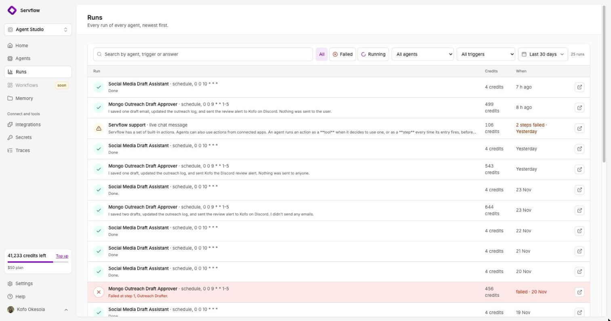
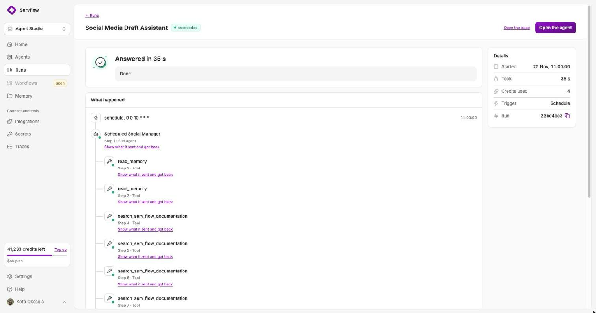

This guide shows you how to read your agents' runs in the dashboard. Use it to see whether an agent did its job, what it answered, how many credits a run used, and where a failed run stopped.

Before you begin, you need an agent that has run at least once. A run is recorded each time an agent's trigger fires, and each time you test the agent with **Run** in the editor.

## Open Runs

<Steps>

<Step title="Open the Runs page">
In the sidebar, click **Runs**. The page lists every run of every agent, newest first.

Each row shows the agent's name, what started the run, a line about how it ended, the credits it used, and when it ran. A green tick marks a run that worked, and a red cross marks a run that failed.

<Frame>
  
</Frame>
</Step>

<Step title="Narrow the list">
To find a run, use the controls above the list:

- Type in **Search by agent, trigger or answer**.
- Under **Status**, choose **Failed** or **Running**.
- Choose one agent instead of **All agents**, or one trigger instead of **All triggers**, such as **Slack** or **Schedule**.
- Pick a time range.

To see more, click **Older runs** at the foot of the list. To start again, click **Clear filters**.

You can also open one agent's runs from the agent editor: click **Runs** in the top bar, then **View all runs**.
</Step>

</Steps>

## Read a run

<Steps>

<Step title="Open the run">
Click a row. The run's page opens with the agent's name and its status: **succeeded**, **failed**, or **running**.

<Frame>
  
</Frame>
</Step>

<Step title="Read the outcome">
The first card says what the run came to. For a run that worked, it reads **Answered in** and the time it took, then shows the agent's answer.

A run that kept going after one step failed reads **Answered, but step** and the step's number. It names the step that failed and says the agent answered without it.

While a run is still going, the card says which step it is on, and the page updates as each step finishes.
</Step>

<Step title="Follow what happened">
Under **What happened**, the run reads from top to bottom in the order the agent ran it:

1. What started the run, with the time. For a run that an app started, click **See what** and the app's name, for example **See what Slack sent**, to read what the app sent.
2. Each step, numbered, marked **Sub agent**, **Tool**, or the action it ran. A tool that a sub agent called sits under that sub agent. Each step shows the credits it used.
3. The answer: **Answered**, or **No answer** when the agent finished without one.

To see what a step sent and what came back, click **Show what it sent and got back** under it.
</Step>

<Step title="Check the details and the cost">
The **Details** card beside the run shows when it **Started**, how long it **Took**, the **Credits used**, the **Trigger**, and the run's id. Credits include the 4-credit run fee. A run that is still going shows its credits when it ends.

For how credits are counted, see [Plans and credits](/concepts/plans-and-credits).
</Step>

</Steps>

## Find a failed run

The dashboard points you to a failed run in three places:

- **Runs** in the sidebar shows a badge such as **2 failed** with the number of today's failed runs.
- **Home** shows the newest failed run of today, with **Open the run**, and a **failed today** count that opens the Runs page on failed runs.
- The Runs page shows a red banner for the newest run that failed in the last day, with **Open the run**.

On a failed run's page, the outcome reads **Failed at step** with the step's number and name. Click **Go to step** and the number. The step that failed is open, and **Came back** shows the error it returned.

If the run failed because a connected account needs signing in again, Home offers **Reconnect** and the integration's name, which opens **Integrations**.

If a run you are looking for is not there, it may be older than your plan keeps. Free keeps 7 days of runs, the $10 plan 14 days, Starter 30 days and Pro 90 days.

## Open the trace

For every step's timing and raw data, click **Open the trace** at the top of a run's page.

## Related

<CardGroup cols={2}>

<Card title="Plans and credits" icon="coins" href="/concepts/plans-and-credits">
  What a run costs and where credits go.
</Card>

<Card title="Top up credits" icon="plus" href="/guides/top-up-credits">
  Add credits when runs stop at zero.
</Card>

<Card title="Add an integration" icon="puzzle-piece" href="/guides/add-an-integration">
  Reconnect an account a run could not use.
</Card>

<Card title="Create an agent" icon="robot" href="/guides/create-an-agent">
  Change what the agent does.
</Card>

</CardGroup>
