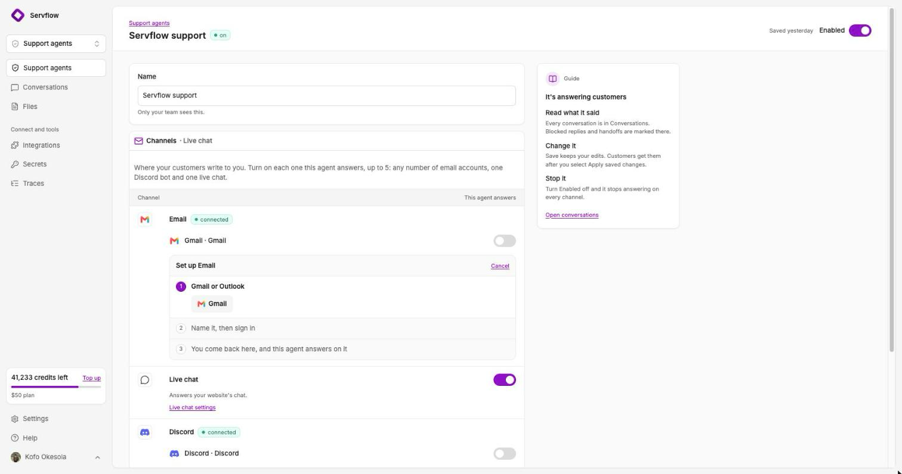
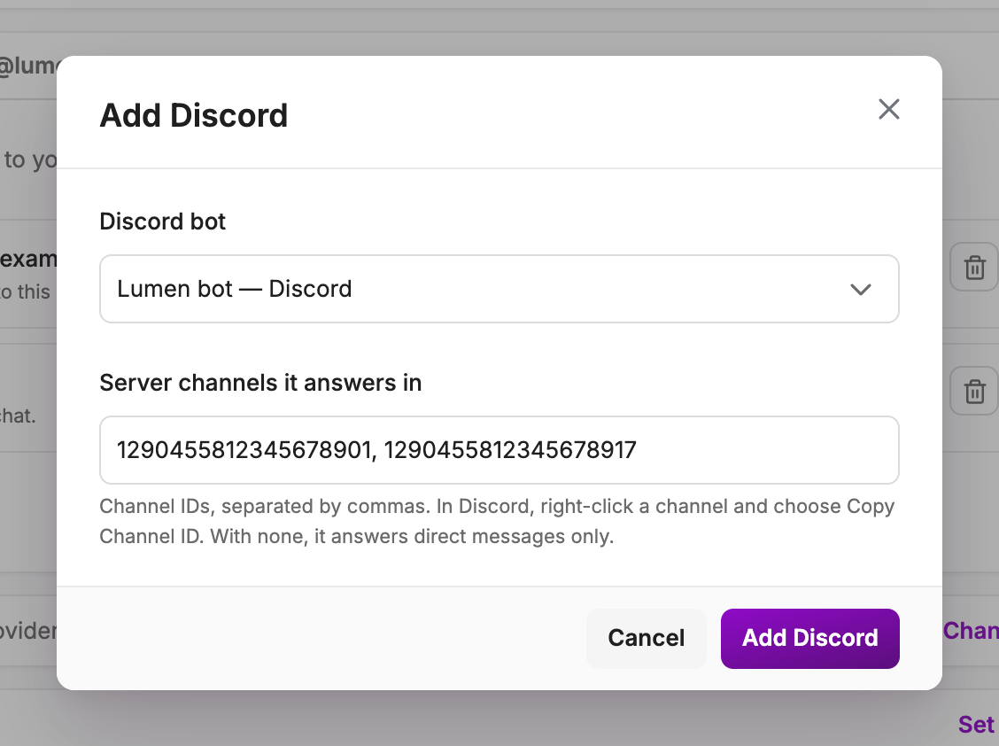
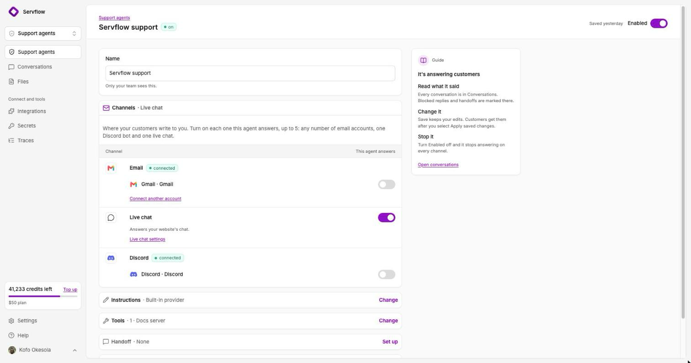

This guide adds a channel to a support agent, so it answers customers who write to that email account, Discord bot or live chat. Use it when you are setting up a support agent, or adding a second place for an existing one to answer. It assumes you have a support agent open in the dashboard; to create one, see [Create a support agent](/guides/create-a-support-agent).

The support agent replies on the channel each message came in on. A channel you add to a support agent that is already on reaches customers only after you click **Save**, then **Apply saved changes**.

## Add an email account

The support agent reads new email to a Gmail or Outlook account and replies from the same account, in the same thread. It ignores mail the account sent itself, and automatic mail such as out-of-office replies, bounces and mailing lists. Email is on paid plans: on the Free plan, the **Email** row shows **Paid plans** and **See plans**.

<Steps>

<Step title="Open Channels">
On the support agent's page, open **Channels**. The **Email** row says **connected** and lists your team's Gmail and Outlook accounts, each with an **Answer on …** switch, or says **not set up** when your team has none.
</Step>

<Step title="Turn on a connected account">
If the account is listed, turn on its **Answer on …** switch. The line under the account changes to "Reads new email to this account and replies from it". Then skip to **Save**.
</Step>

<Step title="Set up a new account">
If the account isn't listed, click **Set up** on the **Email** row, or **Connect another account** under the accounts. **Set up Email** opens in place, under the row.
</Step>

<Step title="Choose Gmail or Outlook">
Under **Gmail or Outlook**, click **Gmail** or **Outlook**.
</Step>

<Step title="Name it and sign in">
Under **Name it, then sign in**, enter a name for the account, for example `Lumen help inbox`, because the dashboard shows that name wherever the channel appears. Click **Connect to Gmail** or **Connect to Outlook**, then sign in and approve the connection on the page that opens.

When you come back to the dashboard, the account is turned on for this support agent, and a line says it is connected and that this agent answers on it. The channel shows as the app and the name, for example **Gmail · Lumen help inbox**.

<Frame>
  
</Frame>
</Step>

<Step title="Save">
Click **Save**. If the support agent is on, click **Apply saved changes** too.
</Step>

</Steps>

To check the channel, send an email to the account from another address. The reply arrives in the same thread, and the conversation appears in **Conversations**.

## Add a Discord bot

The support agent answers through your team's own Discord bot. It answers every message in the server channels you list, without needing a mention, and every direct message to the bot. With no server channels listed, it answers direct messages only. It ignores messages from other bots. Discord is on paid plans: on the Free plan, the **Discord** row shows **Paid plans** and **See plans**.

<Steps>

<Step title="Create the bot in Discord">
If your team has no Discord bot yet, create one in the Discord Developer Portal, copy its token, and invite it to your server. Follow [Create the bot in Discord](/guides/connect-an-agent-to-discord#create-the-bot-in-discord). You don't need the rest of that guide.
</Step>

<Step title="Open Channels">
On the support agent's page, open **Channels**. The **Discord** row says **connected** and lists your team's Discord bots, each with an **Answer on …** switch, or says **not set up** when your team has none.
</Step>

<Step title="Turn on a connected bot">
If the bot is listed, turn on its **Answer on …** switch. It answers direct messages only until you list server channels: click the pencil icon, **Change**, on its line. In the **Change Discord** dialog, enter the channel IDs under **Server channels it answers in**, click **Save** in the dialog. Then skip to **Save**.
</Step>

<Step title="Set up a new bot">
If your team has no Discord bot, click **Set up** on the **Discord** row. **Set up Discord** opens in place, under the row.
</Step>

<Step title="Enter the bot token">
Under **Bot token**, enter a name for the bot, for example `Community Discord`, and paste the bot's token. Click **Next**.
</Step>

<Step title="Choose the server">
Under **Server**, click the server the bot was invited to, or enter its ID under **Server id**. Click **Add integration**.
</Step>

<Step title="List the server channels">
Under **Choose where it answers**, in **Server channels it answers in**, enter the IDs of the channels it should answer in, separated by commas. To copy a channel's ID in Discord, right-click the channel and choose **Copy Channel ID**. A channel ID is digits only. Leave the field empty to answer direct messages only.

<Frame>
  
</Frame>
</Step>

<Step title="Add it">
Click **Add Discord**. The bot's line says where it answers, for example "Answers in 2 server channels and in direct messages".
</Step>

<Step title="Save">
Click **Save**. If the support agent is on, click **Apply saved changes** too.
</Step>

</Steps>

To check the channel, post a question in one of the listed channels, or send the Discord bot a direct message. The reply arrives in the same place.

<Frame>
  
</Frame>

## Add live chat

Live chat is a chat on your own website that the support agent answers. It needs no account or bot, and it is on every plan, Free included. On the support agent's page, open **Channels** and turn on **Answer on Live chat**. Click **Save**, and if the support agent is on, **Apply saved changes**.

The chat itself, its look, the websites it loads on and the code for your site, is set up in **Settings > Live chat**; the **Live chat settings** link on the row opens it. Your team has one live chat, and one support agent answers it at a time, chosen on that page. For the full steps, see [Add live chat to your website](/guides/add-live-chat-to-your-website).

## Channel limits

- **Up to 5 channels** per support agent. When it is full, the switches that are off can't be turned on, and the line under them says "This agent has 5 channels".
- **Any number of email accounts**, but **one Discord bot** and **one live chat** per support agent. For a kind it already has, the line says "This agent has one already".
- **One support agent answers the live chat.** Several support agents can have the live chat channel, but only the one chosen in **Settings > Live chat** answers your website's chat. The line under **Live chat** says whether it does.
- **One support agent per account.** An email account or Discord bot answers for only one support agent that is on at a time. You can add the same account to two support agents, but enabling the second is refused with a message naming the support agent that already answers on it. Turn that one off first, or remove the channel from it.
- **Not as a tool.** An account that is one of the support agent's channels can't also be used by one of its tools.

## Next steps

<CardGroup cols={2}>

<Card title="Create a support agent" icon="headset" href="/guides/create-a-support-agent">
  Write the instructions, save, and enable.
</Card>

<Card title="Add live chat to your website" icon="comments" href="/guides/add-live-chat-to-your-website">
  Set up the chat and paste its code on your site.
</Card>

<Card title="Add an integration" icon="puzzle-piece" href="/guides/add-an-integration">
  Store the credentials your channels and tools use.
</Card>

<Card title="Connect an agent to Discord" icon="discord" href="/guides/connect-an-agent-to-discord">
  Create a Discord bot and add it as an integration.
</Card>

</CardGroup>
