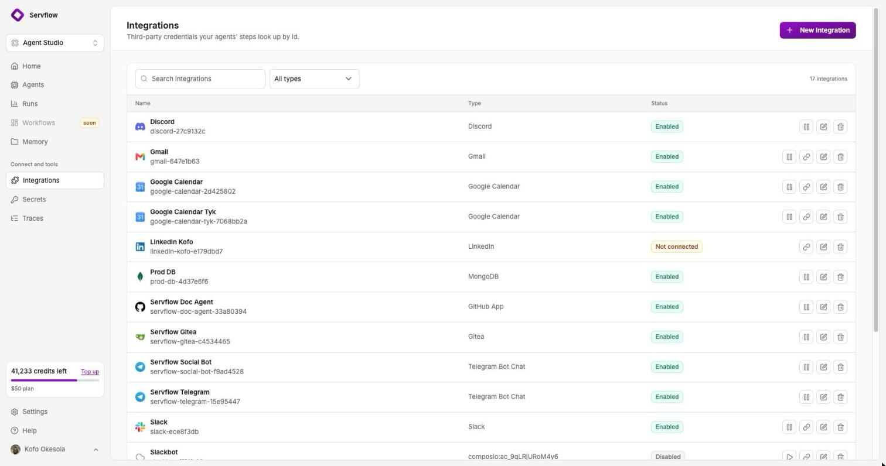
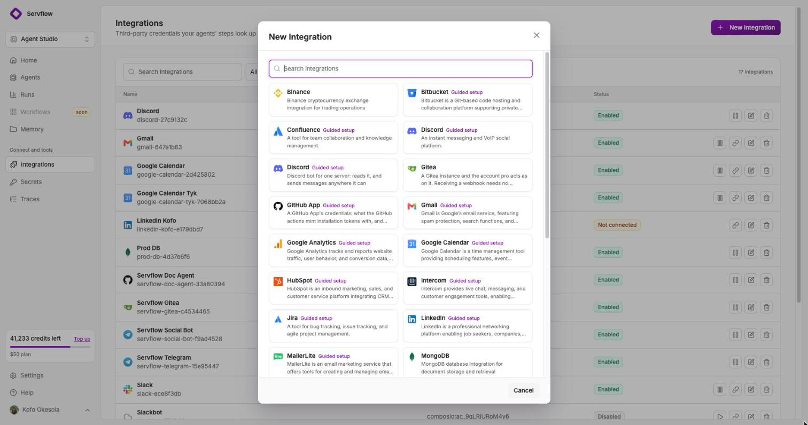
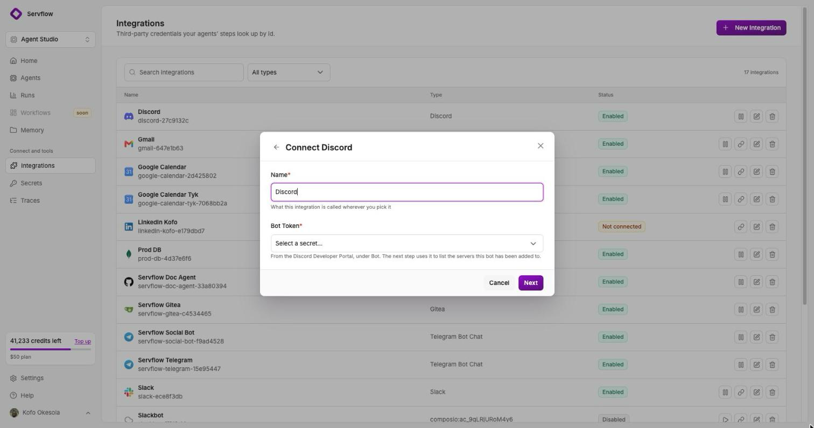
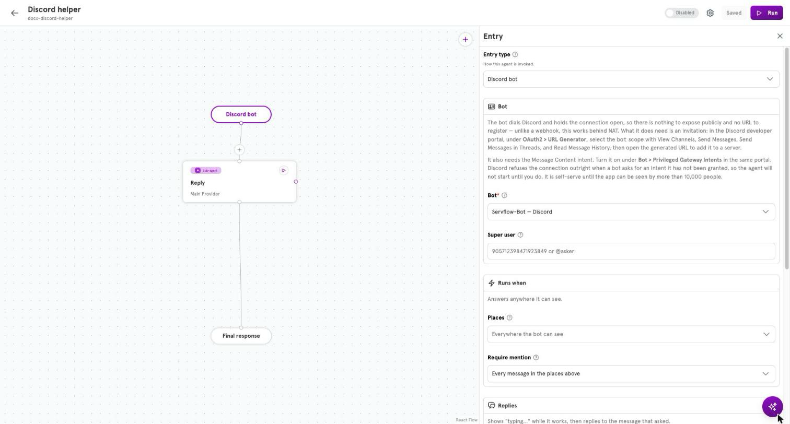
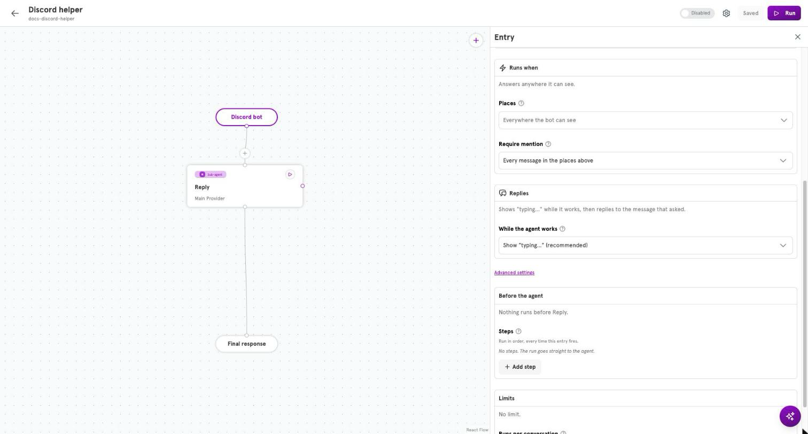
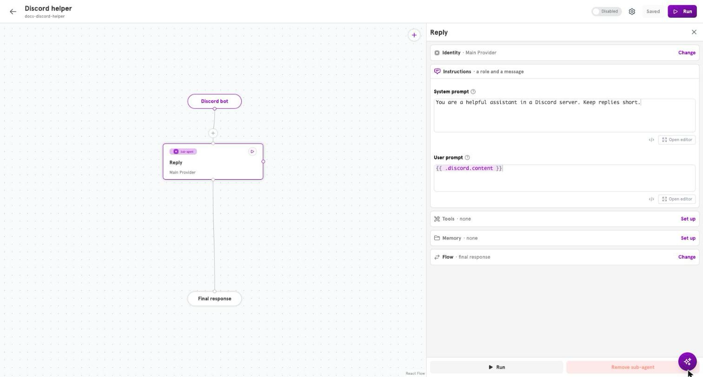
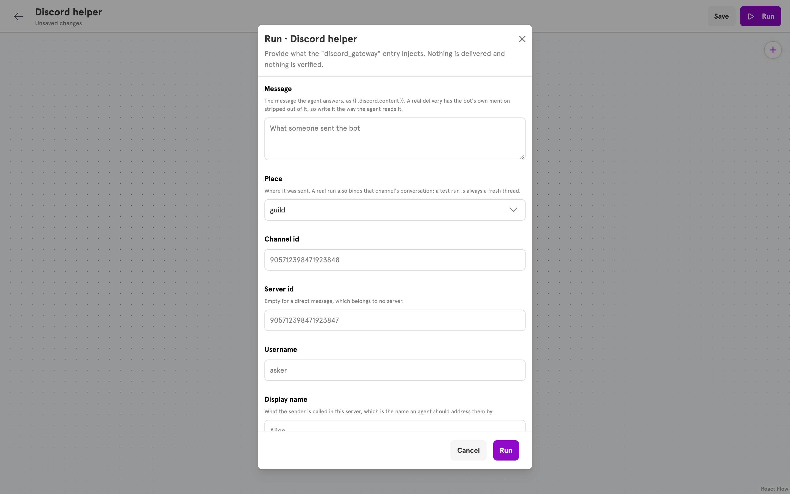

This guide turns an existing agent into a Discord bot that replies when someone mentions it in your server. It covers creating the bot in Discord, adding it to Servflow as an integration, and setting the agent's trigger. The bot holds a connection open to Discord, so the agent needs no public URL and works behind NAT.

## Before you begin

- A Servflow account, or a self-hosted instance with a provider. On Servflow Cloud, a sub agent with no provider runs on your team's [built-in model](/concepts/providers#built-in-model-on-servflow-cloud). To self-host, see [Self-host Servflow](/installation).
- An agent to connect. See [Create an agent](/guides/create-an-agent).
- A Discord account with permission to add bots to the server you want the agent in.

## Create the bot in Discord

These steps happen in the [Discord Developer Portal](https://discord.com/developers/applications), not in Servflow.

1. Create an application, then open its **Bot** page and copy the bot's token. You paste it into Servflow in the next section.
2. On the same page, under **Privileged Gateway Intents**, turn on the **Message Content** intent. Discord refuses the connection when a bot asks for an intent it has not been granted, so the agent does not start without it.
3. Open **OAuth2 > URL Generator**. Select the `bot` scope, then the **View Channels**, **Send Messages**, **Send Messages in Threads**, and **Read Message History** permissions.
4. Open the generated URL and add the bot to your server.

## Add the Discord integration

<Steps>

<Step title="Open Integrations">
In the sidebar under **Connect and tools**, click **Integrations**, then click **New Integration**.

<Frame>
  
</Frame>
</Step>

<Step title="Choose Discord">
Choose **Discord**, which is marked **Guided setup**. The **Connect Discord** dialog opens.

<Frame>
  
</Frame>
</Step>

<Step title="Enter a name and the bot token">
Enter a **Name**, for example `Community Discord`. This is what you will pick later when an agent needs this bot.

Under **Bot Token**, choose a stored secret that holds the token, or choose **+ New secret…** to store it now. To paste the token into the integration instead, choose **Enter a value directly…**. A secret keeps the token out of the integration's config. See [Secrets](/concepts/secrets).

Click **Next**.

<Frame>
  
</Frame>
</Step>

<Step title="Choose the server">
Servflow asks Discord which servers the bot has been added to and lists them. Select your server. If it is not listed, enter its **Server id** directly.

If the bot is in no server yet, the dialog says so. Go back to the invitation step in Discord, then enter the server id.
</Step>

<Step title="Add the integration">
Click **Add integration**. The integration appears in the list on the Integrations page, with the type **Discord** and the status **Disabled**. Open the row's actions and click **Enable integration**. The status changes to **Enabled**.
</Step>

</Steps>

## Set the trigger to Discord

<Steps>

<Step title="Open the Entry panel">
Open the agent and click the trigger box at the top of the canvas. The **Entry** panel opens.
</Step>

<Step title="Choose Discord bot">
Under **Entry type**, choose **Discord bot**. The trigger box relabels to **Discord bot**. A Discord trigger has no path.
</Step>

<Step title="Choose the bot">
Under **Bot**, choose the integration you added.

Optional: under **Super user**, enter one person's Discord user id or `@username`. Every run then tells the prompt whether that person sent the message, so the agent can take instructions from them alone. A user id is safer, because a username can change.

<Frame>
  
</Frame>
</Step>

<Step title="Decide when the agent runs and how it replies">
Under **Runs when**, choose the **Places** the agent answers in. The default is everywhere the bot can see. Keep **Require mention** set to **Only when the bot is mentioned (recommended)**, so the agent answers people addressing it rather than every message in the channel. A direct message never needs a mention.

Under **Replies**, keep **Show "typing…" (recommended)** so people see the agent working until the reply arrives.

<Frame>
  
</Frame>

Optional: **Advanced** narrows the agent to specific servers, channels, or `!` commands, and decides whether it answers other bots. For every field, see [Entry handlers](/references/entry-handlers#discord_gateway).
</Step>

</Steps>

## Read the message in the prompt

Click the agent's first sub agent and set its **User prompt** to the message text:

```
{{ .discord.content }}
```

The bot's own mention is stripped from the message before the agent reads it. The trigger also provides the sender's name, the channel, and whether the sender is the super user. For the full list, see [the Discord trigger's variables](/references/entry-handlers#discord_gateway).

<Frame>
  
</Frame>

## Verify

<Steps>

<Step title="Test on the agent's page">
Click **Run**. For a Discord trigger, the dialog asks for what a message would provide instead of a request body: the **Message**, the **Place**, the channel and server ids, and the sender. Enter a message and click **Run**. Nothing is sent to Discord, and the run panel shows the agent's reply.

<Frame>
  
</Frame>
</Step>

<Step title="Save and enable">
Click **Save**. Saving stores the agent; it does not connect it to Discord. If the agent is disabled, switch **Disabled** to **Enabled** in the top bar. If it is already enabled, click **Apply saved changes** beside the switch. A message confirms, and the agent connects to Discord.
</Step>

<Step title="Mention the bot in Discord">
In a channel the bot can see, mention the bot with a question. The bot shows typing, then replies to your message.
</Step>

</Steps>

## If the bot does not answer

- **The Message Content intent is off.** Discord refuses the connection, so the agent never starts. Turn it on in the Developer Portal.
- **The bot is not in the server.** Open the invitation URL from the Developer Portal again.
- **The message did not mention the bot.** With **Require mention** on, messages that do not mention the bot are ignored.
- **The channel is not allowed.** Check **Places** and **Advanced**.
- **Another agent uses the same bot.** Agents on one bot share a single connection to Discord. Each sees every message the bot can see and decides for itself whether to answer, so narrow each agent to its own channels or commands.
- **The agent is disabled, or your last save is not applied.** Switch the agent to **Enabled**, or click **Apply saved changes**.

## Related

<CardGroup cols={2}>

<Card title="Available entry handlers" icon="right-to-bracket" href="/references/entry-handlers#discord_gateway">
  Every field and variable of the Discord trigger.
</Card>

<Card title="Available integrations" icon="puzzle-piece" href="/references/integrations#discord">
  The Discord integration's fields and what uses it.
</Card>

<Card title="Discord actions" icon="discord" href="/references/actions#discord">
  Send messages and read channel history from an agent's steps.
</Card>

<Card title="Create an agent" icon="robot" href="/guides/create-an-agent">
  Build the agent this guide connects.
</Card>

</CardGroup>
