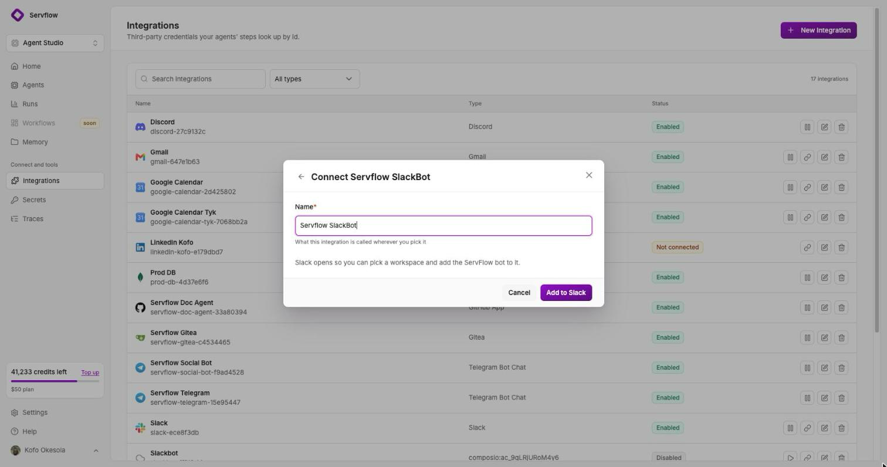

This guide makes an existing agent answer in Slack. The agent replies as the Servflow bot when someone sends the bot a direct message or mentions it in a channel, and it answers in the message's thread. There is no Slack app for you to create: you install Servflow's own bot in your workspace.

Before you begin, you need:

- An agent to connect. See [Create an agent](/guides/create-an-agent) or [Describe an agent with Assist](/guides/describe-an-agent-with-assist).
- Permission to add apps to the Slack workspace you want the agent in.

## Add the Slack integration

<Steps>

<Step title="Open Integrations">
In the sidebar under **Connect and tools**, click **Integrations**, then **New Integration**.
</Step>

<Step title="Choose Servflow SlackBot">
Search for Slack and choose **Servflow SlackBot**, which is marked **Guided setup**.

<Frame>
  
</Frame>
</Step>

<Step title="Name it and install the bot">
Enter a **Name**, for example `Work Slack`. This is what you pick later when an agent answers in this workspace.

Click **Add to Slack**. Slack opens. Pick your workspace and allow the bot.
</Step>

<Step title="Check the integration">
Slack sends you back to **Integrations**. The integration is in the list with the status **Enabled**.

If you leave Slack before allowing the bot, the integration shows **Not connected**. Open the row's actions and click **Connect integration** to try again.
</Step>

</Steps>

## Set the trigger to Slack bot

<Steps>

<Step title="Open the Entry panel">
Open the agent in the editor and click the trigger node at the top of the canvas. The **Entry** panel opens.
</Step>

<Step title="Choose Slack bot">
Under **Entry type**, choose **Slack bot**.
</Step>

<Step title="Choose the workspace">
Under **Slack workspace**, choose the integration you added.

In each workspace, one agent answers direct messages and one answers mentions. If another agent already answers either in this workspace, enabling this one is refused.
</Step>

<Step title="Decide what the agent answers">
Under **Runs when**, each setting starts at **Answer them**:

- **Direct messages**: someone writing to the bot in its Messages tab.
- **Mentions**: someone mentioning the bot in a channel or group DM the bot is in.

Set either to **Ignore them** to turn it off. Keep at least one on.

Under **Thread replies**, keep **Keep answering the thread (recommended)** so people can reply in a thread the bot answered without mentioning it again. A thread that is quiet for a day needs a new mention.
</Step>

</Steps>

## Read the message in the prompt

Click the agent's first sub agent and set its **User prompt** to the message:

```
{{ .slack.text }}
```

The bot's own mention is taken out of the message before the agent reads it. The trigger also gives the sender's name as `{{ .slack.user_name }}`, and whether the message was a direct message as `{{ .slack.is_dm }}`. For every variable, see [Entry handlers](/references/entry-handlers).

## Enable the agent

<Steps>

<Step title="Test in the editor">
Click **Run**. For a Slack bot trigger, the dialog asks for the **Message**, the **Place** (`im` for a direct message), and the sender. Enter a message and click **Run**. Nothing is sent to Slack, and the run panel shows the agent's answer.
</Step>

<Step title="Save and enable">
Click **Save**, then turn on the **Enabled** switch in the top bar. The agent starts listening to the workspace.
</Step>

</Steps>

## Test in Slack

In Slack, open the bot's Messages tab and send it a question, or mention the bot in a channel it is in. The answer arrives in the message's thread. Each thread keeps its own conversation.

The run appears on the **Runs** page with the trigger **Slack**. See [Check what your agent did](/guides/check-what-your-agent-did).

## If the bot does not answer

- **The agent is disabled.** Turn on **Enabled** in the editor.
- **The setting is off.** Check that **Direct messages** or **Mentions** is set to **Answer them** for the kind of message you sent.
- **The bot is not in the channel.** A mention reaches the bot only in a channel or group DM it is in. Add the bot to the channel.
- **The thread went quiet.** After a day without messages, mention the bot again.
- **The bot's access changed.** On **Integrations**, open the row's actions and click **Reinstall in Slack**.

## Related

<CardGroup cols={2}>

<Card title="Run an agent on an app event" icon="bolt" href="/guides/run-an-agent-on-an-app-event">
  Start an agent from an event in a connected app.
</Card>

<Card title="Connect an agent to Discord" icon="discord" href="/guides/connect-an-agent-to-discord">
  Run an agent as a Discord bot.
</Card>

<Card title="Entry handlers" icon="right-to-bracket" href="/references/entry-handlers">
  Every trigger's fields and variables.
</Card>

<Card title="Check what your agent did" icon="list-check" href="/guides/check-what-your-agent-did">
  Read the runs the bot started.
</Card>

</CardGroup>
