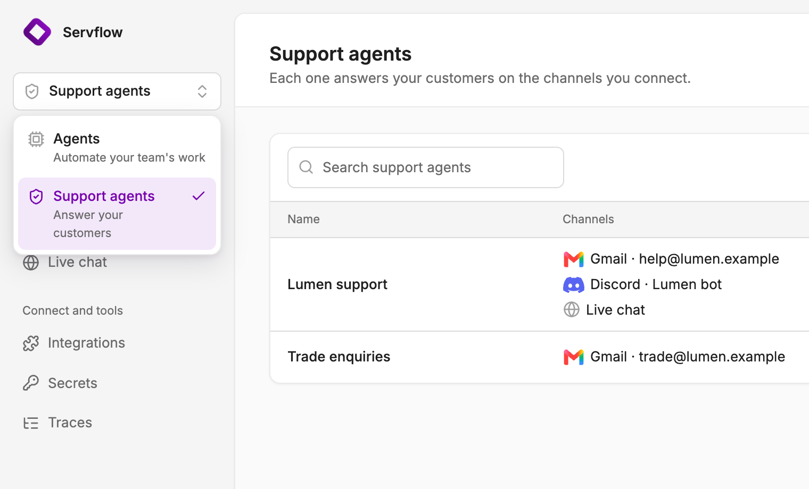
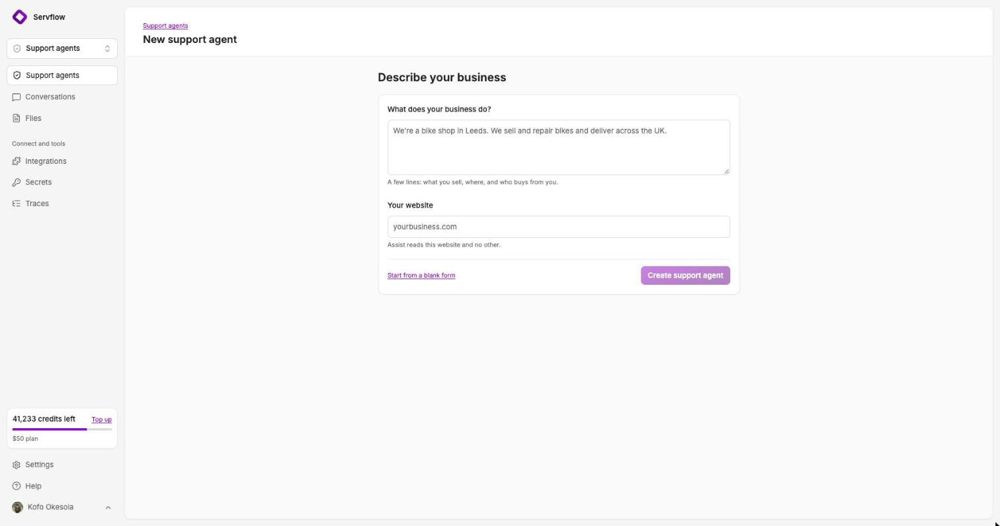
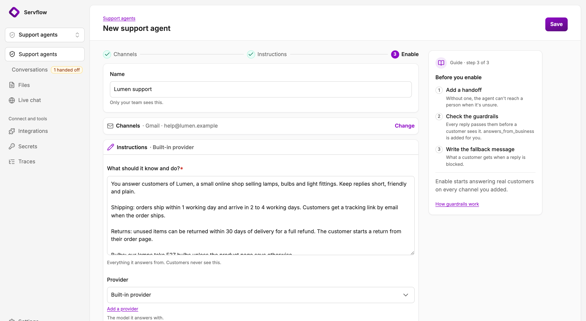
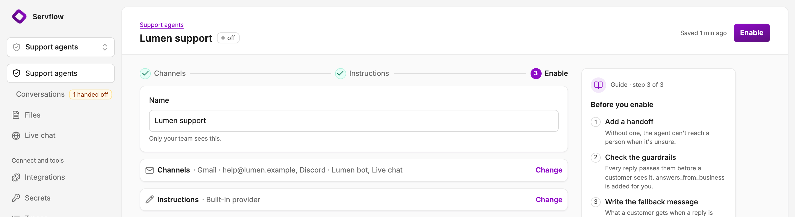
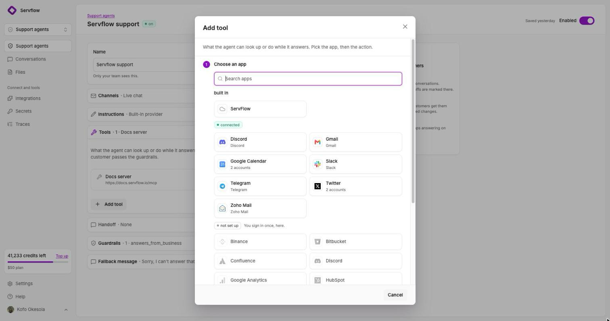
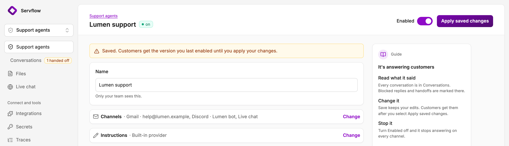

This guide creates a support agent and turns it on, so it starts answering customers who write to your support email address, your Discord server or the live chat on your website. It also covers changing a support agent that is already on, and turning it off. For what a support agent is made of, see [Support agents](/concepts/support-agents).

## Before you begin

- A Servflow team at [dash.servflow.io](https://dash.servflow.io). On the Free plan, your team can have one support agent, and it answers on live chat only; email and Discord are on paid plans. When your team already has as many support agents as its plan allows, **New support agent** opens a notice that says so.
- A channel to answer on: a Gmail or Outlook account, a Discord bot, or your website's live chat. You can connect an email account or Discord bot from inside the form below; see [Connect a support channel](/guides/connect-a-support-channel). Live chat needs no account.
- Optional, on a paid plan: the files your answers come from, added on the **Files** page. See [Add files for your support agents](/guides/add-files).

## Create the support agent

<Steps>

<Step title="Switch to Support agents">
At the top of the sidebar, open the product menu and choose **Support agents**. The sidebar changes to the support agent pages, and the **Support agents** page opens.

<Frame>
  
</Frame>
</Step>

<Step title="Click New support agent">
On the **Support agents** page, click **New support agent**. The **New support agent** page opens on **Describe your business**.

<Frame>
  
</Frame>

To have Assist set the support agent up for you instead, fill in **What does your business do?** and **Your website**, then click **Create support agent**. Assist reads your website, writes the instructions (and files, on a paid plan), and sets up live chat and the guardrails. You then review what it will do and click **Add support agent**.
</Step>

<Step title="Open the blank form">
Click **Start from a blank form**. The form opens with **Name** at the top and a guide beside it that follows you through three stages: **Channels**, **Instructions** and **Enable**.
</Step>

<Step title="Name it">
Under **Name**, enter a name your team will recognise, for example `Lumen support`. Customers never see it.
</Step>

<Step title="Turn on one channel">
**Channels** lists every kind of channel: **Email**, **Live chat** and **Discord**. Email and Discord say **connected** or **not set up**, and list each account your team has connected with an **Answer on …** switch.

- For live chat, turn on **Answer on Live chat**.
- For an email account or Discord bot your team has connected, turn on its **Answer on …** switch.
- For an email account or Discord bot your team hasn't connected, click **Set up** on its row, or **Connect another account** under Email, and follow the set-up that opens in place.

On the Free plan, Email and Discord show **Paid plans**. For the details, see [Connect a support channel](/guides/connect-a-support-channel) and [Add live chat to your website](/guides/add-live-chat-to-your-website). Start with one channel; you can turn on more later.
</Step>

<Step title="Write the instructions">
Open **Instructions**. In **What should it know and do?**, write a brief for the support agent the way you would for a new teammate:

- who your business is, and how to sound
- the facts customers ask for, such as hours, prices, returns and delivery
- when to hand off to a person

To start from a template, click **Use this example** in the guide beside the form, then replace the parts in brackets. The guide also has examples for showing products as cards on live chat and for capturing leads, each with **Add this to the instructions**.

For a fictional bike shop, good instructions look like this:

```
You answer customers of Lumen Cycles, a bike shop in Leeds. Be short and friendly. Sign off as "The Lumen team".

Opening hours: Monday to Saturday, 9:00 to 18:00. Closed Sundays.
Servicing: a basic service is £45 and takes two working days. Customers book by replying with a preferred day.
Returns: unused items can be returned within 30 days with proof of purchase. Bikes that have been ridden can't be returned, but we fix faults for free for a year.
Delivery: free in Leeds, £12 elsewhere in the UK. We don't ship abroad.

Never promise a repair date or a refund amount. If the answer isn't here, or the customer asks for a person, hand off.
```

The support agent answers from these instructions, from your team's files, and from what its tools return. Keep the instructions to a brief, and put long text such as a full returns policy in files instead. See [Files and policy labels](/concepts/files-and-policy-labels).

<Frame>
  
</Frame>
</Step>

<Step title="Choose a provider">
Under **Provider**, keep **Built-in provider**, or choose one of your team's own providers. **Add a provider** opens the page where you add your own key.
</Step>

<Step title="Save">
Click **Save** in the top right. Until the support agent has a name, a channel and instructions, a note above the form says what is still missing, and **Save** stays unavailable.

When the save succeeds, the support agent shows the status **off**, and **Guardrails** lists one guardrail, `answers_from_business`, that Servflow adds for you. If the save is refused, the message appears above the section it concerns.
</Step>

<Step title="Enable">
Before you enable, add a handoff and check the guardrails and fallback message. See [Set up a handoff](/guides/set-up-a-handoff) and [Guardrails on support replies](/concepts/support-guardrails).

Click **Enable**. The status changes to **on**, an **Enabled** switch appears in the top right, and the support agent starts answering customers on every channel you added. A live chat channel also needs the support agent chosen in **Settings > Live chat** before the chat shows on your website.

If it can't be enabled, a message such as "Couldn't enable Lumen support" says why, and the support agent stays off.

<Frame>
  
</Frame>
</Step>

</Steps>

## Verify

Send a message to the channel from an account that is not the support agent's own, for example an email to the connected inbox from your personal address. The reply arrives in the same email thread or Discord channel. For live chat, first choose this support agent in **Settings > Live chat** and add the code to your website; see [Add live chat to your website](/guides/add-live-chat-to-your-website). Then open **Conversations** in the sidebar. The conversation is listed, and opening it shows your message, the reply, and the line **Checked by 1 guardrail**. To read it in detail, see [Read support conversations](/guides/read-support-conversations).

## Add tools

Tools let the support agent look things up or act while it answers, for example check an order in your store. In **Tools**, click **Add tool** and choose **Run action** for an action in one of your apps, or **MCP server** for the tools of a Model Context Protocol server.

**Run action** opens **Add tool**, which starts from the app:

1. Under **Choose an app**, click the app. Apps your team has an account for are listed under **connected**, and apps that need no account under **built in**. An app marked **not set up** asks you to sign in there and then. If your team has more than one account for the app, choose one under **Which account?** and click **Continue**.
2. Under **Choose what it does in** the app, click the action.
3. The tool dialog opens. Name the tool and fill in its fields, as for an agent's tool; see [Add a tool to an agent](/guides/add-a-tool).

<Frame>
  
</Frame>

A tool can't use the email account or Discord bot of one of this support agent's channels. Every reply to a customer has to pass the guardrails, and a tool that sent through a channel would skip them. To pass a customer to a person, use a handoff instead of a tool.

## Change a support agent that is on

Customers keep getting the version you last enabled until you apply your changes, so you can edit without a half-finished change reaching them.

1. Open the support agent from the **Support agents** page and make your changes.
2. Click **Save**. A banner says that customers get the version you last enabled until you apply your changes.
3. Click **Apply saved changes**. The banner goes away, and new replies use the changed instructions, tools, handoffs, guardrails and fallback message.

<Frame>
  
</Frame>

## Turn it off

Switch **Enabled** off in the top right. The status changes to **off**, and the support agent stops answering on every channel. Its conversations stay. To turn it back on, click **Enable**.

To remove a support agent for good, delete it from its row on the **Support agents** page. Its conversation records are deleted with it, and this can't be undone.

## Next steps

<CardGroup cols={2}>

<Card title="Set up a handoff" icon="hand" href="/guides/set-up-a-handoff">
  Let the support agent pass a customer to a person.
</Card>

<Card title="Add files for your support agents" icon="file-arrow-up" href="/guides/add-files">
  Add the files it answers from.
</Card>

<Card title="Add live chat to your website" icon="comments" href="/guides/add-live-chat-to-your-website">
  Answer customers in a chat on your own site.
</Card>

<Card title="Read support conversations" icon="comments" href="/guides/read-support-conversations">
  See what it said, and what it withheld.
</Card>

</CardGroup>
