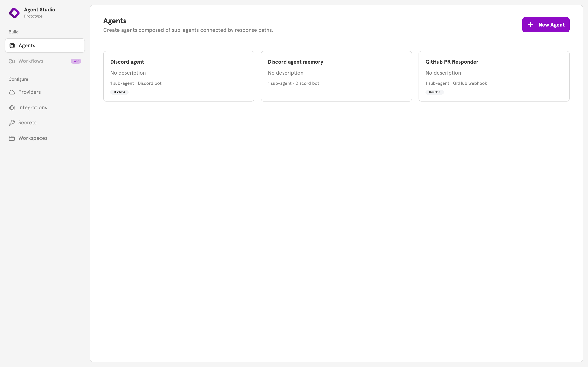
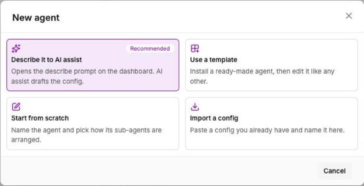
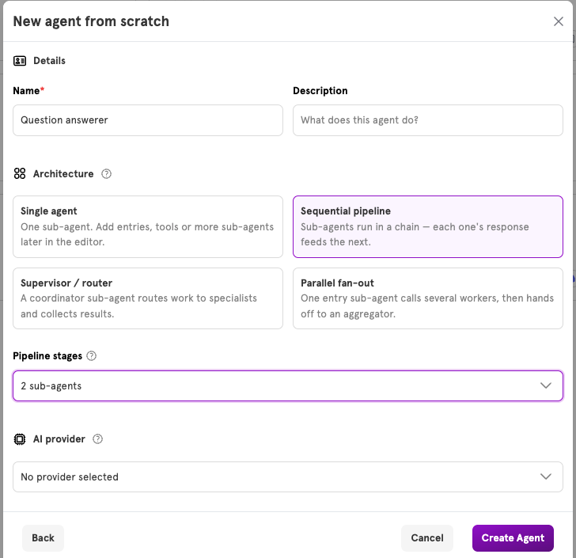
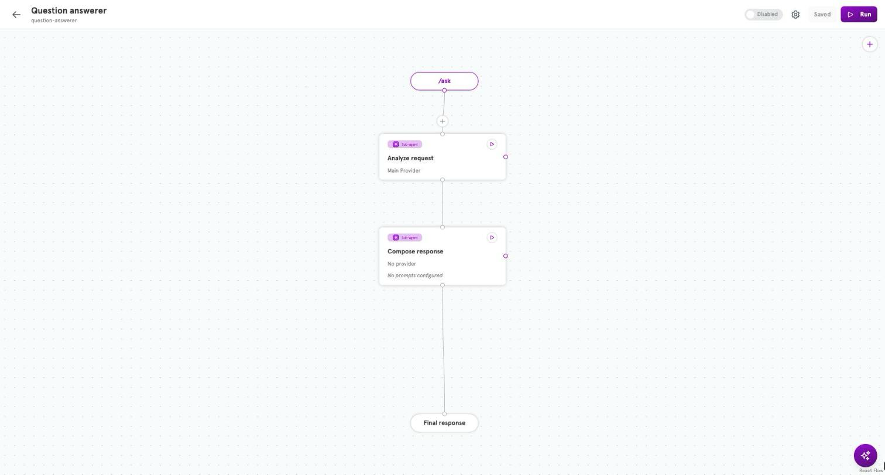
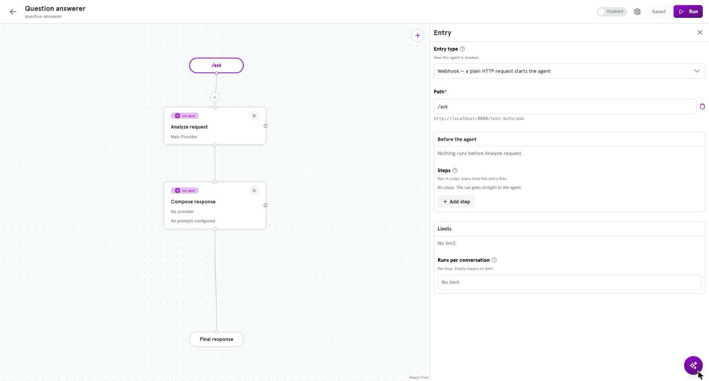
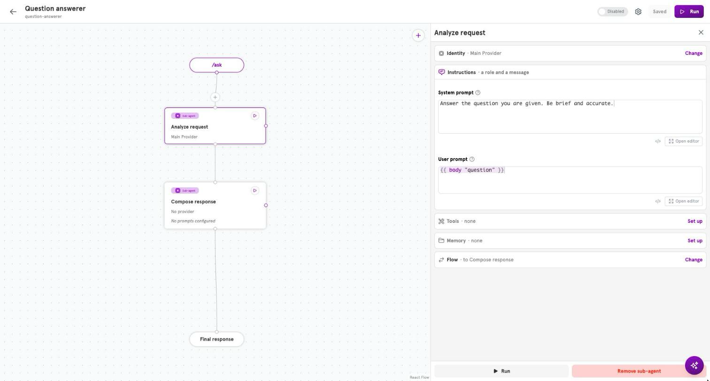
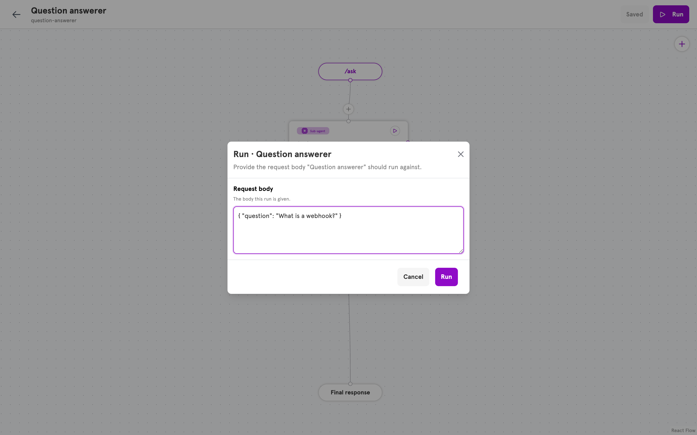
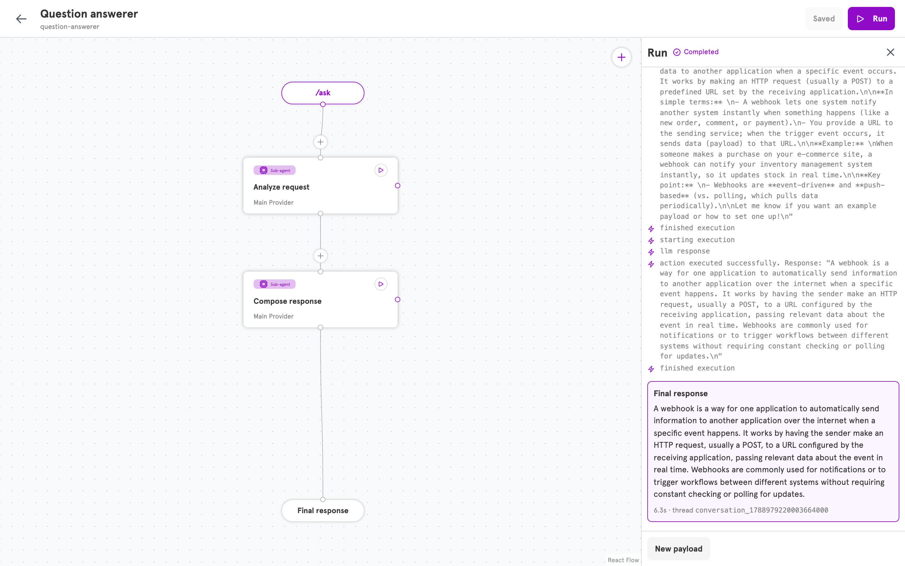

This guide creates an agent that answers an HTTP request. It walks the dashboard from the **New Agent** page to a `curl` call that returns the model's reply, then shows the same job done from a config file. Use it when you want your first agent built by hand, or a new one.

The example is a two-stage pipeline named Question answerer. The first stage answers a question sent in a JSON body and the second rewrites the answer as one paragraph.

## Before you begin

- A Servflow account at [dash.servflow.io](https://dash.servflow.io), or a [self-hosted instance](/installation).
- On a self-hosted instance, a provider. In the sidebar under **Connect and tools**, open **Providers** and add one if the list is empty. See [Manage LLM providers](/guides/manage-llm-providers). On Servflow Cloud you can skip this: a sub agent with no provider runs on your team's [built-in model](/concepts/providers#built-in-model-on-servflow-cloud), paid from its credits. You choose that model in **Settings > Team > Model**.

## Create an agent in the UI

### Create the agent

<Steps>

<Step title="Open the Agents page and click New Agent">
In the sidebar, click **Agents**. On a self-hosted instance it is under **Build**. Click **New Agent** in the top right. The **New agent** dialog opens and asks how to start.

<Frame>
  
</Frame>
</Step>

<Step title="Choose Start from scratch">
Choose **Start from scratch**. The **Details** group appears.

<Frame>
  
</Frame>

The other choices open the agent in the same place as the rest of this guide:

| Choice | What it does |
|---|---|
| **Describe it to AI assist** | Opens the describe prompt on **Home**. Assist drafts the agent for you to review. Servflow Cloud only. See [Describe an agent with Assist](/guides/describe-an-agent-with-assist). |
| **Use a template** | Installs a template, an agent that already works, which you then edit like any other. Servflow Cloud only. |
| **Import a config** | Takes a config you already have, pasted as YAML or JSON. |
</Step>

<Step title="Name the agent">
Enter a **Name**, for example `Question answerer`. Optional: add a **Description**. The **Architecture** group appears.
</Step>

<Step title="Choose an architecture">
Choose **Sequential pipeline** and set **Pipeline stages** to `2 sub-agents`. The **AI provider** group appears.

<Frame>
  
</Frame>

| Architecture | What it scaffolds |
|---|---|
| Single agent | One sub agent. You can give it a **Schedule**. Add triggers, tools, or more sub agents later on the canvas. |
| Sequential pipeline | Sub agents run in a chain. Each one's reply feeds the next. |
| Supervisor / router | A coordinator sub agent routes work to specialists and collects results. |
| Parallel fan-out | One dispatcher sub agent calls several workers, then hands off to an aggregator. |
</Step>

<Step title="Choose a provider">
Under **AI provider**, choose the model every sub agent runs on. On Servflow Cloud, keep **No provider selected** to use your team's [built-in model](/concepts/providers#built-in-model-on-servflow-cloud). On a self-hosted instance, you can choose **Choose later** and pick one per sub agent on the canvas.
</Step>

<Step title="Click Create Agent">
Click **Create Agent**. The agent opens on a canvas with four boxes from top to bottom: the trigger, labelled **Manual trigger**, the sub agents **Analyze request** and **Compose response**, and **Final response**. The agent is saved but disabled, and its id, `question-answerer`, is derived from the name.

<Frame>
  
</Frame>
</Step>

</Steps>

### Set the trigger

The trigger decides how a run starts. A new agent starts by hand or on a schedule. To make it answer HTTP requests:

<Steps>

<Step title="Open the Entry panel">
Click the **Manual trigger** box. The **Entry** panel opens on the right.
</Step>

<Step title="Choose the webhook trigger">
Under **Entry type**, choose **Webhook — a plain HTTP request starts the agent**. A **Path** field appears.
</Step>

<Step title="Enter a path">
Enter `/ask`. The trigger box on the canvas relabels to `/ask`. The agent answers `POST` requests on that path.

<Frame>
  
</Frame>
</Step>

</Steps>

**Entry type** lists every trigger, and each has its own fields:

| Trigger | What starts a run |
|---|---|
| **Trigger — run manually or on a schedule** | A run from the agent's page, another agent, or a schedule. |
| **Webhook — a plain HTTP request starts the agent** | An HTTP request to the trigger's path. |
| **Streamable HTTP webhook** | An HTTP request, answered as Server-Sent Events while the agent runs. |
| **GitHub webhook** | A delivery from a GitHub App, such as a new comment or pull request. |
| **Gitea webhook** | A delivery from a Gitea instance, such as a comment, a new pull request, or a push. |
| **Telegram bot** | A message to a Telegram bot. |
| **Discord bot** | A message to a Discord bot. See [Connect an agent to Discord](/guides/connect-an-agent-to-discord). |
| **Slack bot** | A direct message or mention of the Servflow bot in Slack. See [Connect an agent to Slack](/guides/connect-an-agent-to-slack). |
| **App event** | Something happening in a connected app, such as a new email. It's listed once your team has an app that offers events. See [Run an agent when something happens in an app](/guides/run-an-agent-on-an-app-event). |

For every field, see [Entry handlers](/references/entry-handlers).

### Configure the sub agents

<Steps>

<Step title="Open the first sub agent">
Click the **Analyze request** box. Its panel opens.
</Step>

<Step title="Choose a provider">
If you chose a provider when you created the agent, it is already set. Otherwise, under **Provider**, choose one. On Servflow Cloud, you can keep **No provider selected** to run on your team's built-in model.
</Step>

<Step title="Write the prompts">
Under **Instructions**, enter a **System prompt**:

```
Answer the question you are given. Be brief and accurate.
```

Enter a **User prompt** that reads the request body:

```
{{ body "question" }}
```

The `body` function reads a field from a JSON request body.

<Frame>
  
</Frame>
</Step>

<Step title="Configure the second sub agent">
Click the **Compose response** box. Choose the same provider and enter a **System prompt**:

```
Rewrite the answer you receive as one clear paragraph.
```

Leave its **User prompt** empty. In a pipeline, a stage receives the previous stage's reply.
</Step>

<Step title="Save">
Click **Save** in the top bar. The button reads **Saved**. Saving stores the agent; it doesn't enable it.
</Step>

</Steps>

### Verify

Test the agent from its page first:

<Steps>

<Step title="Click Run">
Click **Run** in the top bar. The run dialog asks for a **Request body**.
</Step>

<Step title="Enter a request body and run">
Enter the body and click **Run**:

```json
{ "question": "What is a webhook?" }
```

<Frame>
  
</Frame>
</Step>

<Step title="Read the result">
The **Run** panel shows **Completed**, a log of each sub agent's turn, and a **Final response** block with the reply and duration. **New payload** runs it again with a different body.

<Frame>
  
</Frame>
</Step>

</Steps>

Then enable it and call it from outside. A new agent doesn't answer requests until it's enabled. In the top bar, switch **Disabled** to **Enabled**. A message confirms **Agent enabled**. If the agent can't be built, for example because a sub agent has no provider on a self-hosted instance, the message says why and the switch stays off.

After you change an enabled agent and save, it keeps running the previous version until you click **Apply saved changes** beside the switch.

In a local servflowai instance the webhook answers at the trigger's path itself, so the response body is the agent's reply:

```bash
curl -X POST http://localhost:8080/ask \
  -H 'Content-Type: application/json' \
  -d '{"question": "What is a webhook?"}'
```

On Servflow Cloud, the agent has its own address. Open the **Entry** panel and copy the full URL under **Path**.

The `body` function only reads requests sent with `Content-Type: application/json`.

## Create an agent from the CLI or MCP

If you keep agents in files, describe the agent in a JSON or YAML document and create it with the `resource` command. It writes to the same store the dashboard uses, and a created agent is disabled until you enable it.

```bash
servflowai resource agent create -f agent.yaml --dry-run   # check it
servflowai resource agent create -f agent.yaml            # create it
servflowai resource agent enable question-answerer        # enable it
```

The agent from the first section, reduced to one sub agent, looks like this. Replace `providerID` with a provider id from `servflowai resource provider list`.

```yaml
name: Question answerer
config:
  entries:
    - type: handler
      handlerConfig:
        path: /ask
      start: agent.answer
  agents:
    answer:
      name: Answerer
      providerID: openai-production
      systemPrompt: Answer the question you are given. Be brief and accurate.
      userPrompt: '{{ body "question" }}'
      next: end
```

For every command and the shape of an agent, see the [CLI reference](/references/cli).

## Related

<CardGroup cols={2}>

<Card title="Available entry handlers" icon="right-to-bracket" href="/references/entry-handlers">
  Every trigger, its fields, and the variables it injects.
</Card>

<Card title="Agents" icon="robot" href="/concepts/agents">
  What an agent is made of: triggers, their steps, and sub agents.
</Card>

<Card title="Dynamic content" icon="code" href="/concepts/dynamic-content">
  Template functions such as `body`, `param`, and `secret`.
</Card>

<Card title="Self-host Servflow" icon="server" href="/installation">
  Run Servflow on your own machine.
</Card>

</CardGroup>
