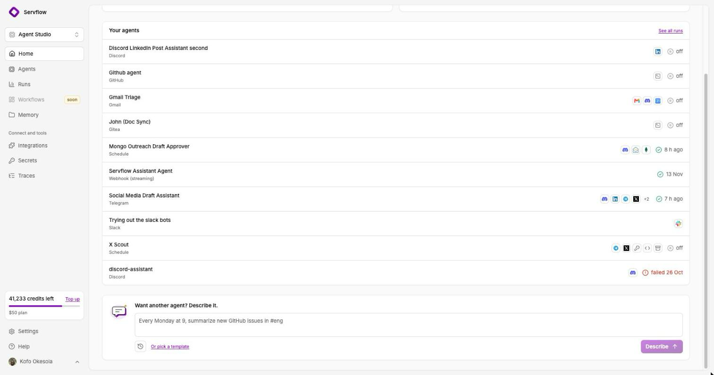

This guide gets you a working agent by describing the job in your own words. Assist builds the agent, you test it, and later you change it by describing the change. Use it if you have never built an agent.

Before you begin, you need to be signed in to your team on the dashboard, with credits left. Each message to Assist uses credits; see [What a message costs](#what-a-message-costs).

## Describe the job

<Steps>

<Step title="Open Home">
In the sidebar, click **Home**. Before you have an agent, Home asks you to **Describe the agent you want to build**. Once you have one, the box is at the foot of the page, under **Want another agent? Describe it.**

<Frame>
  
</Frame>
</Step>

<Step title="Describe the agent">
Say what starts the agent and what it should do. For example: `Every Monday at 9, summarize new GitHub issues in #eng`. You can also click one of the suggested prompts under the box.

Click **Describe**. Home turns into a chat with Assist. Assist may ask you a question before it builds anything. Answer it in the box at the foot of the chat.
</Step>

</Steps>

## Review what Assist built

When Assist has an agent for you, its answer holds a card with the agent's name and what is in it: how many sub agents, triggers and steps. Under **To fill in the agent**, the card lists anything Assist left for you, such as an account it needs.

<Steps>

<Step title="Preview the agent">
On the card, click **Preview**. The **Import an agent config** dialog opens with the agent's **Name** and **Config** filled in.
</Step>

<Step title="Choose the model">
Under **AI provider**, keep **No provider selected** to run the agent on your team's built-in model, paid from your credits. To use your own key instead, choose it from the list. See [Providers](/concepts/providers).
</Step>

<Step title="Create the agent">
Click **Create Agent**. The agent opens in the editor, with its trigger, steps and sub agents on the canvas. Fill in anything the card listed, such as an integration the agent uses, then click **Save**.
</Step>

</Steps>

## Test the agent

<Steps>

<Step title="Run it">
In the editor's top bar, click **Run**. The dialog asks for what the agent's trigger would give it, such as a message or a request body. Enter it, then click **Run**. The run panel shows each step as it runs and the agent's answer.
</Step>

<Step title="Enable it">
When the test answers the way you want, turn on the **Enabled** switch in the top bar. The agent now runs on its own each time its trigger fires.
</Step>

</Steps>

## Ask Assist to change it

<Steps>

<Step title="Open Assist in the editor">
Open the agent in the editor. Click the Assist button in the bottom-right corner. The **AI assist** window opens.
</Step>

<Step title="Describe the change">
Type what you want changed, for example `Make the system prompt shorter`, and send it. Assist reads the agent as it is on the canvas, including changes you have not saved.
</Step>

<Step title="Review the changes">
When Assist proposes a change, click **Preview** on its card. The **Review changes** dialog opens. Each tab, **General**, **Entries**, **Sub agents** and **Tools**, lists what would be added, removed or changed. **To fill in after applying** lists anything you still need to set.

Click **Apply changes** to put the changes on the canvas, or **Discard** to leave the agent as it is.
</Step>

<Step title="Save and apply">
Click **Save**. If the agent is enabled, it keeps running its earlier version until you click **Apply saved changes** beside the **Enabled** switch.
</Step>

</Steps>

To return to an earlier conversation on Home, click **Past conversations** under the box.

## What a message costs

Each message you send to Assist costs 2 credits, plus the AI it uses at what it costs. The agent Assist builds then costs what any run costs. See [Plans and credits](/concepts/plans-and-credits).

If your team has no credits left, Assist does not take new messages until you [top up](/guides/top-up-credits).

## Related

<CardGroup cols={2}>

<Card title="Create an agent" icon="robot" href="/guides/create-an-agent">
  Build an agent in the editor yourself.
</Card>

<Card title="Check what your agent did" icon="list-check" href="/guides/check-what-your-agent-did">
  Read the agent's runs once it is enabled.
</Card>

<Card title="Plans and credits" icon="coins" href="/concepts/plans-and-credits">
  What a run and a message cost.
</Card>

<Card title="Add an integration" icon="puzzle-piece" href="/guides/add-an-integration">
  Connect an account the agent needs.
</Card>

</CardGroup>
