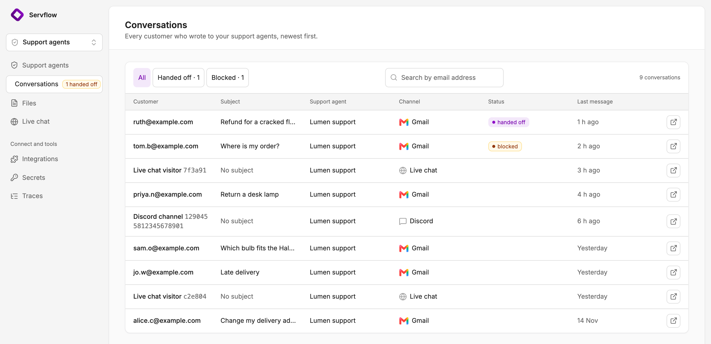
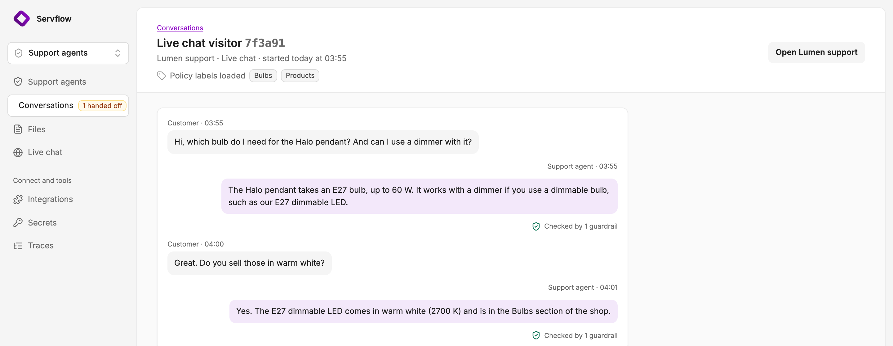
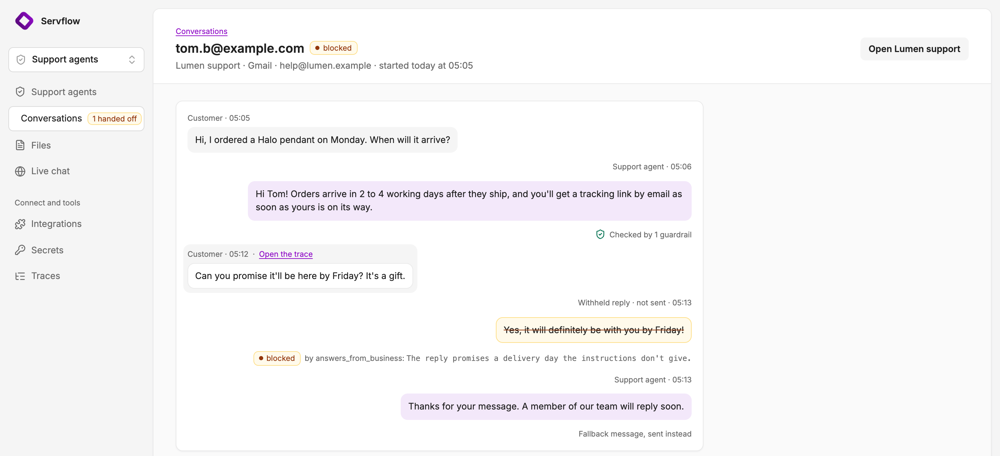
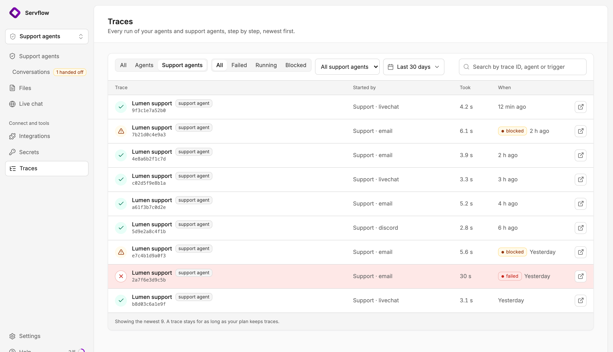

This guide shows how to check on a support agent that is on: find the conversations that need you, read what the support agent said and what the guardrails withheld, and change the support agent when a reply was wrong. Use it in the first days after you enable a support agent, and whenever the sidebar shows conversations handed off.

## Find the conversations that need you

<Steps>

<Step title="Open Conversations">
With **Support agents** chosen in the product menu, click **Conversations** in the sidebar. When conversations are handed off, the sidebar shows how many beside **Conversations**.

The list shows every customer who wrote to your support agents, newest message first, with the columns **Customer**, **Subject**, **Support agent**, **Channel**, **Status** and **Last message**. The customer is an email address. A Discord conversation shows the customer's Discord username, or **Discord channel** and the channel's ID, and a live chat conversation shows **Live chat visitor** and the conversation's ID, because the chat doesn't ask customers who they are. **Status** shows **handed off** or **blocked**; an open conversation with nothing withheld has no status.

<Frame>
  
</Frame>
</Step>

<Step title="Filter the list">
Choose **Handed off** to see the conversations a person should take over, or **Blocked** to see those where a reply was withheld. Each filter shows its count. If you have more than one support agent, choose one from the list beside the filters. To find one customer, type the start of their email address in **Search by email address**. The search finds email conversations only; a customer on live chat has no email address to search by.
</Step>

<Step title="Open a conversation">
Click a row. The conversation page shows the customer and status, a line with the support agent, the channel, the inbox and when it started, and the messages in order: the customer on the left, the support agent on the right. A tool the support agent ran shows as one line, **Ran** and the tool's name; click the arrow to see what it returned.
</Step>

</Steps>

## See which files it answered from

When a customer's message matched a policy label, the conversation page shows **Policy labels loaded** under the header, followed by each label. The files with those labels loaded for that message and for every later message in the conversation, along with every file that has no policy label. A conversation with no line loaded only the files with no policy label.

<Frame>
  
</Frame>

If a reply lacked a fact that is in a labelled file, check whether that file's label loaded here. If it didn't, give the file a label that names the customer's question more plainly, or remove its labels so the file loads in every answer. See [Files and policy labels](/concepts/files-and-policy-labels).

## Read a withheld reply

Under a reply that passed, a line says how many guardrails checked it, for example **Checked by 2 guardrails**.

When a guardrail blocks a reply, the support agent writes it once more with the guardrails' reasons. If the new reply passes, the page shows only that reply, as any other reply that passed, and the conversation is not marked **blocked**. The first reply and why it was blocked are in the run's trace.

When a reply was withheld, because the second reply was blocked too or a check couldn't run, the page shows it struck through under **Withheld reply · not sent**, so you can read what the support agent wanted to say. Under it is the reason:

- **blocked** and the guardrail's name, with the reason it gave, when a guardrail blocked the reply.
- **failed** and the guardrail's name, with the error, when the check couldn't run.

Below that is the message the customer actually received, labelled **Fallback message, sent instead**.

<Frame>
  
</Frame>

For what counts as blocked, see [Guardrails on support replies](/concepts/support-guardrails).

## See the cards a reply showed

On live chat, a reply that showed products as cards has them in a box under it, headed with how many were sent, for example "2 cards sent on live chat". Each row shows the card's picture, title, line such as the price, and link.

Under a withheld reply, the box says the cards were withheld with the reply and not sent, and their titles are struck through. The line under the fallback message ends with "No cards.", because the customer got neither. If the support agent's call to show cards failed, it shows as a tool line with the error open instead. See [Show products as cards in live chat](/guides/show-cards-in-live-chat).

## Read a handoff

A handed-off conversation opens with a note: which handoff ran and when, the summary the support agent wrote for the person taking over, and **Open the handoff trace**. If the customer wrote again afterwards, the note says when and, for an email conversation, tells you to reply from that inbox. The support agent won't answer again.

If a handoff failed, a note says so and that nobody was told, and names the integration to check. See [Set up a handoff](/guides/set-up-a-handoff#when-a-handoff-fails).

## Open the trace

Every customer message starts a run, and the run's trace shows each part of it: what the support agent read, each tool it called and what came back, the guardrail checks, and any error. To open it, hover over the customer's message and click **Open the trace** beside the time. On a phone, the link is always shown.

Traces are kept for a limited number of days on your plan. For an older message, the page says the trace is no longer kept.

To look across runs instead of one conversation, click **Traces** in the sidebar. From the support side it opens on **Support agents** runs. Under **Status**, choose **Failed** for runs that errored, for example when the loaded files went over their limit, or **Blocked** for runs where a guardrail withheld the reply. Choose one support agent from the list to narrow it further.

<Frame>
  
</Frame>

## Fix what went wrong

To open the support agent, click the **Open** button with its name at the top of the conversation page. Then change the part that caused the problem:

- **The reply was wrong, or it lacked a fact.** Correct the file it came from on the **Files** page, or add the fact there. For tone and behaviour, change **Instructions**.
- **The files went over their limit.** Give long files a policy label, or split them, so fewer characters load for one message.
- **A good reply was blocked.** Reword the guardrail named in the reason, so it says more exactly what a reply must do.
- **A bad reply got through.** Add a guardrail that would have caught it.
- **It handed off too often, or not when it should.** Change the handoff's **When should the agent hand off?**

For a change to the support agent, click **Save**, then **Apply saved changes**. Until you apply them, customers get the version you last enabled. A change on the **Files** page applies from the next customer message, with nothing to apply. See [Create a support agent](/guides/create-a-support-agent#change-a-support-agent-that-is-on).

A change applies to new replies only. A withheld reply is not sent again, and a handed-off conversation stays with your team.

## Next steps

<CardGroup cols={2}>

<Card title="Guardrails on support replies" icon="shield-check" href="/concepts/support-guardrails">
  How the check works, and how to write a better rule.
</Card>

<Card title="Set up a handoff" icon="hand" href="/guides/set-up-a-handoff">
  Change who is told, and when.
</Card>

<Card title="Create a support agent" icon="headset" href="/guides/create-a-support-agent">
  Change a support agent that is on.
</Card>

<Card title="Support agents" icon="headset" href="/concepts/support-agents">
  How a reply travels, from customer to handoff.
</Card>

</CardGroup>
