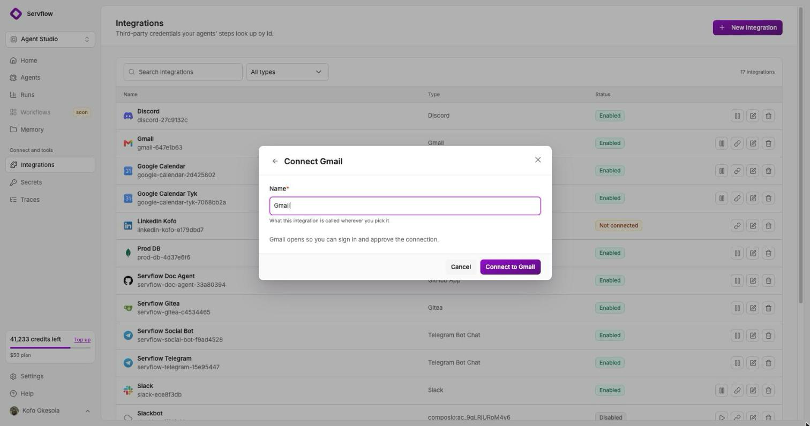
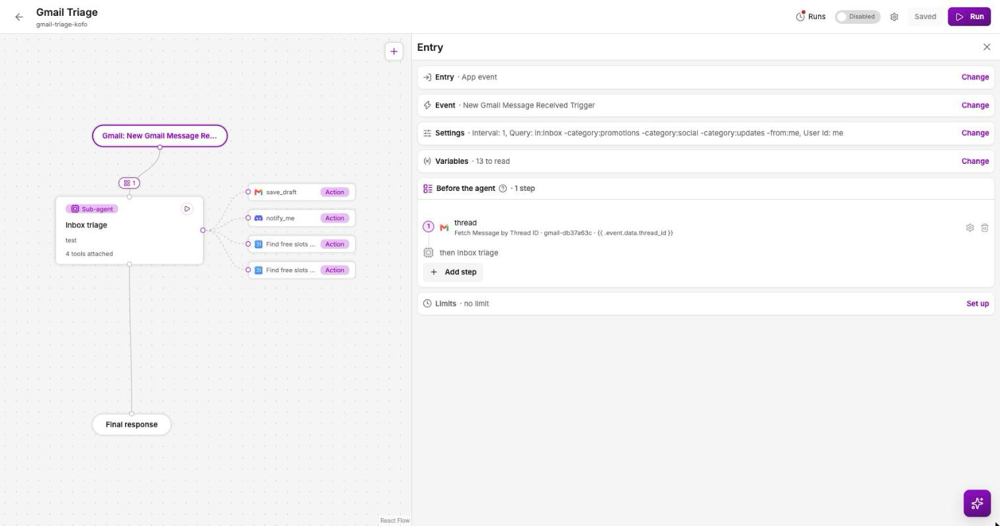

This guide starts an agent each time something happens in an app you use, such as a new email in Gmail or a new event in Google Calendar. You connect your account once, then set the agent's trigger to the event.

Before you begin, you need:

- An agent to start. See [Create an agent](/guides/create-an-agent) or [Describe an agent with Assist](/guides/describe-an-agent-with-assist).
- An account in the app, and permission to sign in to it.

The apps that offer events include Gmail, Google Calendar, Slack, Notion, Jira, Confluence, HubSpot, Discord, WhatsApp and MailerLite.

## Connect the app

<Steps>

<Step title="Open Integrations">
In the sidebar under **Connect and tools**, click **Integrations**, then **New Integration**.
</Step>

<Step title="Choose the app">
Search for the app, for example `Gmail`, and choose it. The app is marked **Guided setup**.
</Step>

<Step title="Name it and sign in">
Enter a **Name**, for example `Work Gmail`. This is what you pick later when an agent uses this account.

Click **Connect to** and the app's name. The app's sign-in page opens. Sign in and approve the connection.

<Frame>
  
</Frame>
</Step>

<Step title="Check the integration">
The sign-in sends you back to **Integrations**. The account is in the list with the status **Enabled**.

If you leave the sign-in before approving, the account shows **Not connected**. Open the row's actions and click **Connect integration** to try again.
</Step>

</Steps>

## Set the trigger to App event

<Steps>

<Step title="Open the Entry panel">
Open the agent in the editor and click the trigger node at the top of the canvas. The **Entry** panel opens.
</Step>

<Step title="Choose App event">
Under **Entry type**, choose **App event**.
</Step>

<Step title="Pick the app, the event and the account">
Under **Event**:

1. Under **App**, choose the app, for example **Gmail**.
2. Under **Event**, choose what starts the agent, for example **New Gmail Message Received Trigger**. The help under the field says what the event is.
3. Under **Account**, choose the account you connected.

<Frame>
  
</Frame>

Some apps are checked for new events about every 15 minutes, so a run can start a few minutes after the event. When that applies, the help under **Event** says so.
</Step>

<Step title="Adjust the settings">
If the event has settings, they appear under **Settings**. A Gmail message, for example, can be narrowed with **Label Ids** or **Query**. Leave a setting empty to use the event's default.
</Step>

</Steps>

## Read the event in the prompt

Under **Variables**, the **Entry** panel lists what the agent can read about the event. Each one reads as `{{ .event.data.<name> }}`. For a new Gmail message, set the first sub agent's **User prompt** to something like:

```
From: {{ .event.data.sender }}
Subject: {{ .event.data.subject }}

{{ .event.data.message_text }}
```

To give the agent the whole event, use `{{ .event.json }}`.

The agent does not reply in the app on its own. To reply or act there, give the agent a tool from the same app on the same account. See [Add a tool](/guides/add-a-tool).

## Enable and test

<Steps>

<Step title="Test in the editor">
Click **Run**. The dialog asks for the event's fields, such as the sender and the subject. Fill in the ones the prompt reads and click **Run**. The run panel shows the agent's answer.
</Step>

<Step title="Save and enable">
Click **Save**, then turn on the **Enabled** switch in the top bar. The agent starts watching the account for the event.
</Step>

<Step title="Make the event happen">
Make the event happen in the app, for example send yourself an email. The run appears on the **Runs** page with the trigger **App event**. See [Check what your agent did](/guides/check-what-your-agent-did).
</Step>

</Steps>

## Related

<CardGroup cols={2}>

<Card title="Add an integration" icon="puzzle-piece" href="/guides/add-an-integration">
  Connect other accounts.
</Card>

<Card title="Add a tool" icon="wrench" href="/guides/add-a-tool">
  Let the agent reply or act in the app.
</Card>

<Card title="Connect an agent to Slack" icon="slack" href="/guides/connect-an-agent-to-slack">
  Answer messages as the Servflow bot.
</Card>

<Card title="Check what your agent did" icon="list-check" href="/guides/check-what-your-agent-did">
  Read the runs an event started.
</Card>

</CardGroup>
