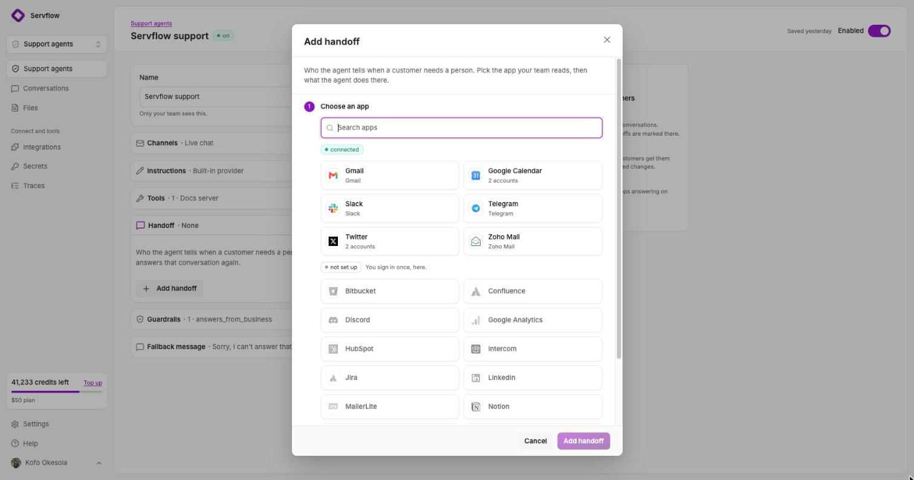
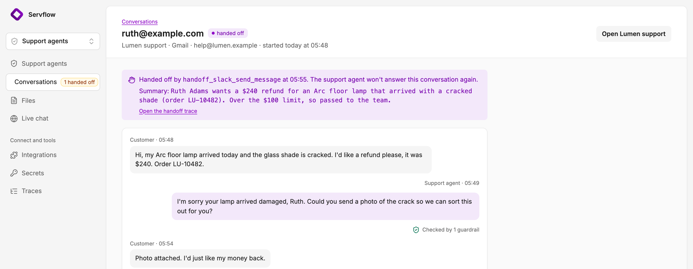

This guide adds a handoff to a support agent: the way it tells a person on your team that a customer needs them. A handoff runs one action in one of your connected apps, such as sending an email or posting a message. Without a handoff, the support agent can't reach anyone when it should not answer. It assumes you have a support agent open in the dashboard; see [Create a support agent](/guides/create-a-support-agent).

## Before you begin

- The app the person reads, for example the Gmail account your support lead reads. If your team hasn't connected it yet, you sign in to it from the handoff dialog.

## Add a handoff

<Steps>

<Step title="Open Handoff">
On the support agent's page, open **Handoff** and click **Add handoff**. The **Add handoff** dialog opens.
</Step>

<Step title="Choose the app">
Under **Choose an app**, click the app the person reads. Apps your team has an account for are listed under **connected**. An app marked **not set up** asks you to sign in to it there and then; when you come back, the dialog opens again with the new account chosen. If your team has more than one account for the app, choose one under **Which account?** and click **Continue**.
</Step>

<Step title="Choose what it does there">
Under **Choose what it does in** the app, search for and click the action that reaches the person, for example the app's action that sends an email or posts a message. To pick another app or action later, click **Change** beside it.
</Step>

<Step title="Fill in the action's fields">
Under **Fill it in, and say when to hand off**, set each field to a fixed value, such as the address of your support lead. For a field the support agent should write itself, such as the message body, click **Let the model set this**. Every required field needs a value or has to be left to the model; otherwise the save is refused with the name of the missing field.

<Frame>
  
</Frame>
</Step>

<Step title="Write when to hand off">
In **When should the agent hand off?**, describe the cases in plain words. The support agent reads this description when it decides whether to hand off; see the examples in the next section.
</Step>

<Step title="Add it and save">
Click **Add handoff**. The handoff appears in **Handoff** as the app, the integration's name and the action, with your description under it. Click **Save**. If the support agent is on, click **Apply saved changes** too.
</Step>

</Steps>

A support agent can have more than one handoff, for example one for billing questions and one for everything else. Give each a description that says when it applies.

## Write when to hand off

The support agent decides on its own when to hand off, from this description and its instructions. Name the situations plainly, the way you would tell a new teammate when to fetch you:

- `When the customer asks for a person, or the answer isn't in your instructions.`
- `When the customer asks for a refund, reports a damaged order, or is unhappy with how we handled something.`
- `When the question is about an invoice, a payment or a business account.`

Keep the instructions consistent with it. A line in the instructions such as "If the answer isn't here, or the customer asks for a person, hand off" points the support agent at the handoff too.

## What the person receives

The person receives what the action sends, made of the fixed values you set and the fields you left to the model. For example, an email action with a fixed recipient and the body left to the model sends your support lead an email that the support agent writes about this customer.

When it hands off, the support agent also writes a short summary of what the customer needs. The summary is kept on the conversation in the dashboard, for whoever takes over.

## What happens after a handoff

- The conversation is marked **handed off**, and **Conversations** in the sidebar shows how many conversations are handed off.
- The support agent never answers that conversation again, even when the customer writes back. A person takes it from here.
- In your website's live chat, the customer's message box is replaced by **Start a new chat**, which opens a new conversation with the support agent.
- The conversation page says which handoff ran and when, shows the summary, and links to **Open the handoff trace**.
- If the customer writes again, the conversation page says when and, for an email conversation, tells you to reply to them from that inbox.

<Frame>
  
</Frame>

## When a handoff fails

If the action fails, nobody is told. The conversation is not handed off: it stays open, and the support agent keeps answering it.

The conversation page then shows a note that says the handoff failed and nobody was told, names the integration to check on the **Integrations** page, and, for an email conversation, tells you to reply from that inbox. **Open the trace** shows the error. Fix the integration, then reply to the customer yourself. To find these conversations, see [Read support conversations](/guides/read-support-conversations).

## Next steps

<CardGroup cols={2}>

<Card title="Read support conversations" icon="comments" href="/guides/read-support-conversations">
  Find handed-off conversations and read what happened.
</Card>

<Card title="Guardrails on support replies" icon="shield-check" href="/concepts/support-guardrails">
  How each reply is checked before it is sent.
</Card>

<Card title="Support agents" icon="headset" href="/concepts/support-agents">
  How a reply travels, from customer to handoff.
</Card>

<Card title="Add an integration" icon="puzzle-piece" href="/guides/add-an-integration">
  Connect the app a handoff uses.
</Card>

</CardGroup>
