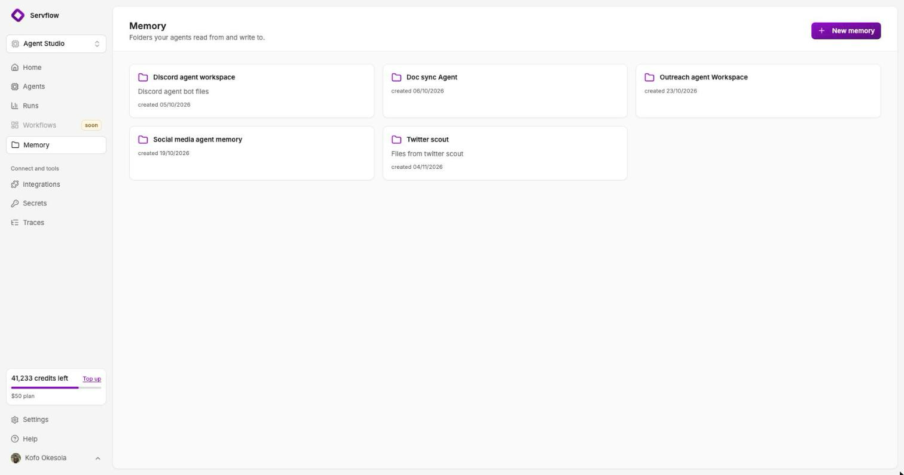
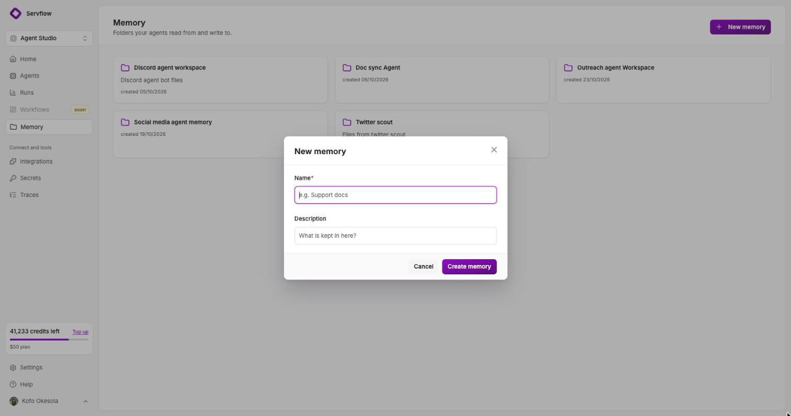
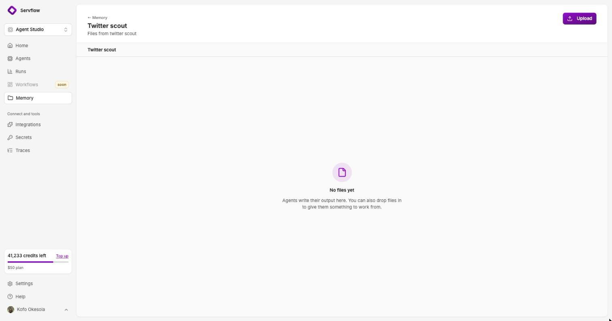
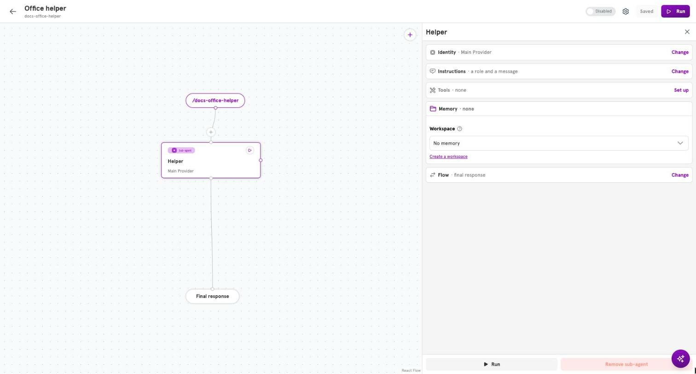
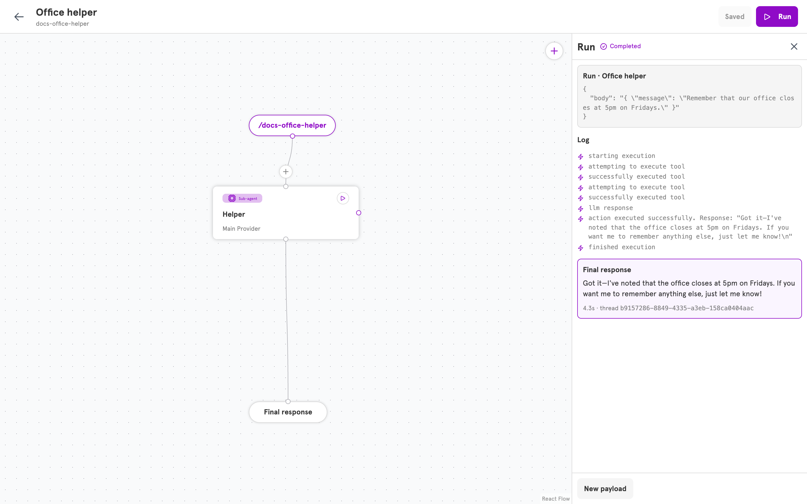
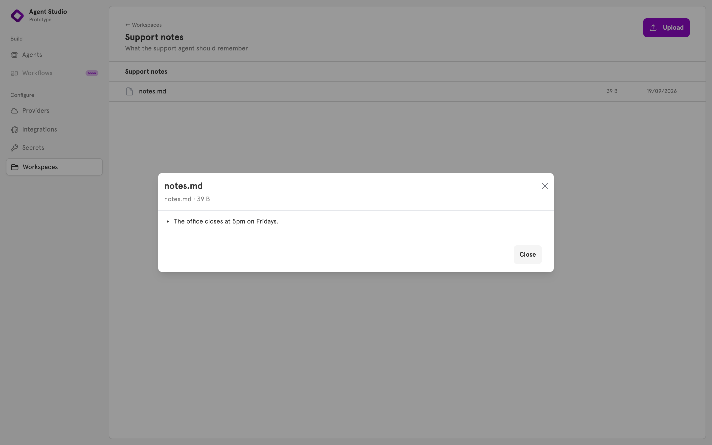

A memory is a folder your agent can read from and write to. This guide creates one, gives it to a sub agent, and checks that the agent can save a note and find it again on a later run.

## Before you begin

- An agent with at least one sub agent. See [Create an agent](/guides/create-an-agent).
- The check at the end runs the agent twice. On Servflow Cloud, runs on the built-in model spend your team's credits. With your own provider, your model company bills you for the AI. See [Plans and credits](/concepts/plans-and-credits).

## Create a memory

<Steps>

<Step title="Open the Memory page">
In the sidebar, click **Memory**.

<Frame>
  
</Frame>
</Step>

<Step title="Click New memory">
Click **New memory**. The **New memory** dialog opens.
</Step>

<Step title="Name the memory">
Enter a **Name**, such as `Support notes`, and a **Description**. Click **Create memory**. The memory appears in the list.

<Frame>
  
</Frame>
</Step>

</Steps>

## Add your own files

<Steps>

<Step title="Open the memory">
Optional: to give the agent documents to work from, click the memory in the list. A new memory reads "No files yet".

<Frame>
  
</Frame>
</Step>

<Step title="Upload files">
Click **Upload**, or drop files anywhere on the page. The files appear in the list.
</Step>

</Steps>

The agent reads text files, such as `.md`, `.txt`, `.csv`, and `.json`. It cannot read pictures, PDFs, or other files that are not text.

## Give the memory to a sub agent

<Steps>

<Step title="Open the sub agent">
Open your agent and click the sub agent on the canvas. Its panel opens.
</Step>

<Step title="Choose the memory">
Scroll to **Memory**. Under **Workspace**, choose your memory. The section's summary changes from "none" to the memory's name.

<Frame>
  
</Frame>
</Step>

</Steps>

The sub agent can now list, read, and write files in the memory. There is nothing else to switch on.

## Tell the agent how to use the memory

The agent now has the ability, but it needs the instruction. Without one, it answers from the message alone and leaves the files untouched.

<Steps>

<Step title="Add instructions to the system prompt">
In the sub agent's **System prompt**, say which file to use and when:

```
You keep your notes in a file called notes.md.
Before every answer, use read_memory to read notes.md. If it does not exist yet, carry on without it.
When someone asks you to remember something, read notes.md, add the new note, and use write_memory to save the whole file.
```

The last line asks for the whole file because writing a file replaces what was in it.
</Step>

<Step title="Save">
Click **Save** in the top bar.
</Step>

</Steps>

## Verify

<Steps>

<Step title="Ask the agent to remember something">
Click **Run**, enter a request that fits your agent's prompt, and click **Run**. For an agent that reads `{{ body "message" }}`:

```json
{ "message": "Remember that our office closes at 5pm on Fridays." }
```

The **Log** in the **Run** panel shows "attempting to execute tool" and "successfully executed tool" twice, once for reading the notes and once for saving them, and the agent confirms.

<Frame>
  
</Frame>
</Step>

<Step title="Read the note in the dashboard">
In the sidebar, click **Memory** and open your memory. `notes.md` is in the list. Click it to read it.

<Frame>
  
</Frame>
</Step>

<Step title="Ask for it back">
Run the agent again with a question the note answers:

```json
{ "message": "When does the office close on Fridays?" }
```

The log shows one tool step, and the agent answers from the note. Each run from the agent's page is a new conversation, so the agent can only know this from the file.
</Step>

</Steps>

## Remove a file or a memory

To delete a file, open the memory, hover the file's row, click the delete icon, and confirm.

Before you delete a memory, open every sub agent that uses it and choose another memory, or **No memory**. An agent left pointing at a deleted memory fails on its next run. Deleting a memory removes it from Servflow and leaves its files on the server's disk.

## Manage memory from the CLI

In the CLI, a memory is a `workspace`. To create one from a file:

```bash
servflowai resource workspace create -f workspace.json
```

For every command and the body it takes, see the [CLI reference](/references/cli#workspace).

## Related

<CardGroup cols={2}>

<Card title="Memory and files" icon="folder-open" href="/concepts/workspaces-and-files">
  What a memory is, and how it differs from the conversation an agent remembers on its own.
</Card>

<Card title="Triggers" icon="right-to-bracket" href="/concepts/entries#what-the-agent-remembers">
  What an agent remembers within a conversation.
</Card>

<Card title="Guard rails" icon="shield-halved" href="/concepts/guard-rails">
  Limit what people can make your agent do.
</Card>

<Card title="Add a tool to an agent" icon="wrench" href="/guides/add-a-tool">
  Give a sub agent other abilities.
</Card>

</CardGroup>
