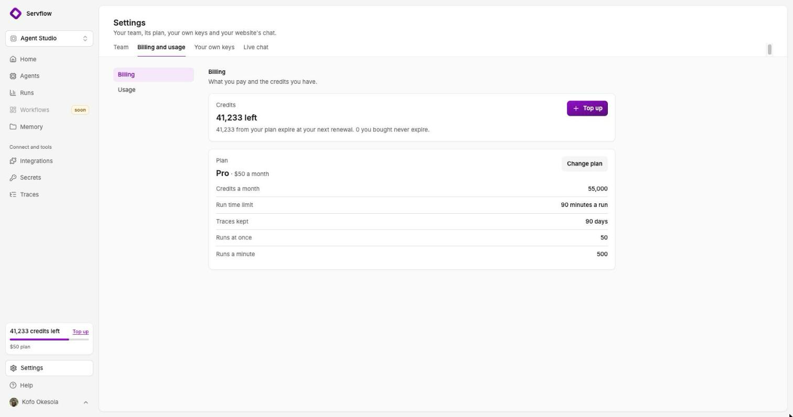

This guide adds credits to your team's balance. Use it when your credits are low, or when runs have stopped because your credits ran out.

Before you begin, you need to be signed in to your team on the dashboard. Any team can top up, on any plan, Free included.

## Top up

<Steps>

<Step title="Open Billing and usage">
In the sidebar, click **Settings**, then the **Billing and usage** tab.

The **Credits** card shows how many credits you have left. On a paid plan it also shows when the plan renews and with how many credits.

<Frame>
  
</Frame>
</Step>

<Step title="Choose an amount">
On the **Credits** card, click **Top up**. Choose one of the amounts: **5,000**, **10,000**, **25,000** or **50,000** credits.

For another amount, type it in **Other**. You can buy from 5,000 to 500,000 credits, in thousands.

The line under the amounts shows the price. Credits cost $1 for 1,000, with no fee, so 10,000 credits cost $10.
</Step>

<Step title="Pay">
Click **Pay** and the price. Stripe opens. Pay there.

When the payment is done, the dashboard shows **Payment received**. Click **Continue** to go back to **Billing and usage**.
</Step>

</Steps>

## Check the balance

On **Billing and usage**, the **Credits** card shows the new balance. The credits appear as soon as the payment clears. If runs had stopped, they start again then.

The line under the balance says how many of your credits are plan credits that expire at your next renewal. Credits you buy never expire.

Under **Usage**, **Credits this period** shows how many of your plan's credits you have used, and **Runs since you joined** and **Built-in AI since you joined** show what your agents have spent.

## Change plan

A plan gives you credits every month instead of one top-up at a time.

<Steps>

<Step title="Open the plans">
On the **Plan** card, click **Choose a plan** on Free, or **Change plan** on a paid plan. The plans open side by side.
</Step>

<Step title="Choose a plan">
On Free, click **Choose** and the plan's name, then pay on Stripe. The plan's credits arrive when you pay, and the credits you already have stay.

On a paid plan, click **Switch to** and the plan's name. Stripe's billing portal opens, where you change or cancel your plan. Moving up gives you the new plan's credits at once.
</Step>

</Steps>

## Related

<CardGroup cols={2}>

<Card title="Plans and credits" icon="coins" href="/concepts/plans-and-credits">
  What credits pay for and when they expire.
</Card>

<Card title="Check what your agent did" icon="list-check" href="/guides/check-what-your-agent-did">
  See what each run cost.
</Card>

</CardGroup>
