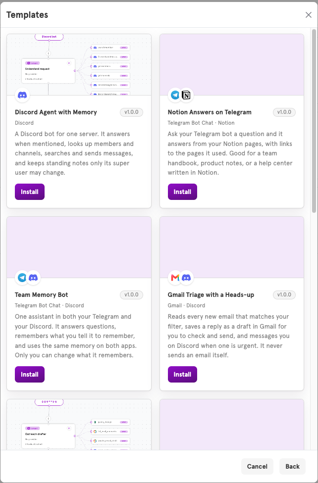
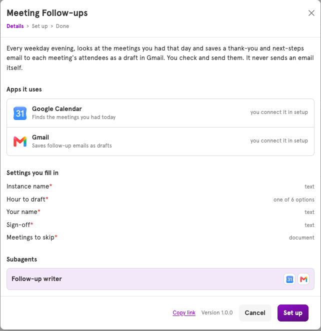
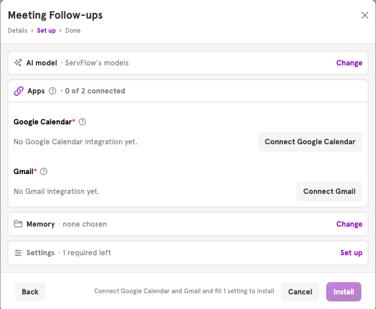
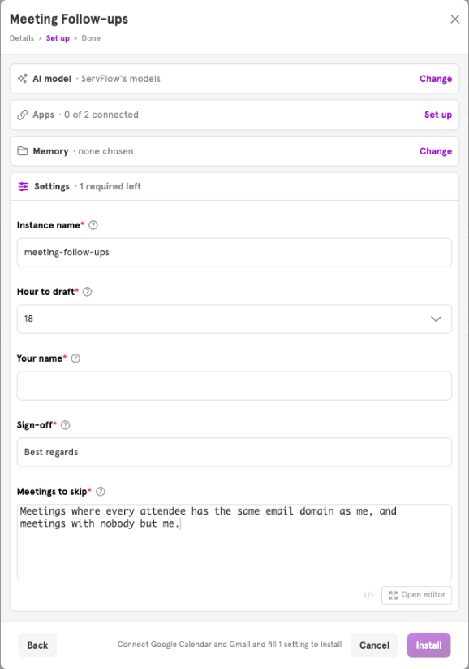
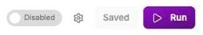

This guide takes you from a new account to an agent working in your calendar and inbox. You set up the **Meeting Follow-ups** template. Every weekday evening it looks at the meetings you had that day and saves a thank-you and next-steps email to each meeting's attendees as a draft in Gmail. It never sends anything, so it's safe to try with your real accounts.

It takes about ten minutes, and you need no code and no AI account of your own.

## Before you begin

- A Google account with Google Calendar and Gmail.
- To see a draft today: a meeting earlier today in your calendar with at least one attendee outside your company.

## Create your team

<Steps>

<Step title="Sign up">
Go to [dash.servflow.io](https://dash.servflow.io) and sign up. The setup opens on **Name your team**.
</Step>

<Step title="Name your team">
Your team owns every agent and integration you make. Fill in the fields:

- **Team name** is what your teammates see. You can rename it later.
- **Address** forms part of your agents' web addresses. It follows the team name unless you change it, and it can't be changed later.

Select the box to agree to the Terms of Service and the Privacy Policy, then click **Continue**. In **Confirm your team identifier**, click **Create team**. The setup moves on to **What should your first agent do?**
</Step>

</Steps>

## Set up the template

<Steps>

<Step title="Pick what it does">
Click **Personal assistant**. The templates for that job appear below it.

<Frame>
  
</Frame>

Click **Meeting Follow-ups**, then click **Set up Meeting Follow-ups**. The next page shows the agent the template sets up, the apps it uses, and the settings you fill in.

<Frame>
  
</Frame>

Under **The agent**, **Model** shows **Servflow model**, which pays for the AI from your team's credits. Your team starts with 4,000 credits on the Free plan. To use your own AI account instead, click **Use your own key**.
</Step>

<Step title="Connect your apps">
Click **Connect Google Calendar**. In the dialog that opens, click **Connect to Google Calendar**, then sign in to Google and allow access. When you come back, the row reads **connected**. Then do the same with **Connect Gmail**.

The agent only reads your calendar, and it only saves drafts in Gmail. You connect each app once, and every agent on your team can then use it.

<Frame>
  
</Frame>
</Step>

<Step title="Fill in the settings">
Under **Its settings**, in **Your name**, type the name that signs each email. The emails are written in your voice.

<Frame>
  
</Frame>

The other settings keep their defaults: the drafts are written at 18:00 UTC, signed off with `Best regards`, and meetings with only your own colleagues, or with nobody but you, are skipped. You can change them in the agent later.

Click **Continue**. Servflow creates the agent, and the setup moves on to **Enable Meeting Follow-ups**.
</Step>

<Step title="Enable it">
A new agent is disabled until you enable it. The page shows when it runs and how many credits your team has left. Each run costs the AI it uses plus a 4-credit run fee.

Click **Enable**. The agent now runs every weekday at the hour it's set to, and the setup moves on to the first run.

If Servflow can't build the agent, the page says why, such as an app that isn't connected, and the agent stays disabled. Click **Edit the agent** to fix it.
</Step>

<Step title="See its first run">
You don't have to wait for the evening. Click **Run it now**. The agent runs once, straight away, and each step appears as it finishes.

When the run ends, the page says **It worked.** and shows **What it answered**: one line for each meeting, saying whether the agent drafted a follow-up or skipped it. Open Gmail and look in **Drafts**. Edit the drafts as you like, and send them yourself.

If you had no meetings today, or every meeting was skipped, the agent saves nothing, and its answer says why.

Click **Continue**.
</Step>

<Step title="Tell us about your team">
Choose **Your role** and **People on the team**, then click **Save and go to your agents**. You can also click **Skip**. The dashboard opens.
</Step>

</Steps>

## See what your agent did

Every time an agent runs, Servflow records it.

1. In the sidebar, click **Agents**. At the foot of the agent's card, **Last run** says how long ago it ran and whether it **succeeded** or **failed**.
2. Click **Runs →** to see its recent runs, then click a run to open it.

To read a run step by step, see [Check what your agent did](/guides/check-what-your-agent-did).

## Change it later

The template set up an ordinary agent, so you can change anything about it. To change how the emails are written, open the agent from the **Agents** page and click the **Follow-up writer** box on the canvas.

To stop the agent, switch **Enabled** to **Disabled** in the agent's top bar.

<Frame>
  
</Frame>

## Next steps

<CardGroup cols={2}>
  <Card title="What Servflow does" icon="house" href="/">
    What agents are made of, and what else you can build.
  </Card>
  <Card title="Create an agent" icon="robot" href="/guides/create-an-agent">
    Build an agent of your own from scratch.
  </Card>
</CardGroup>
