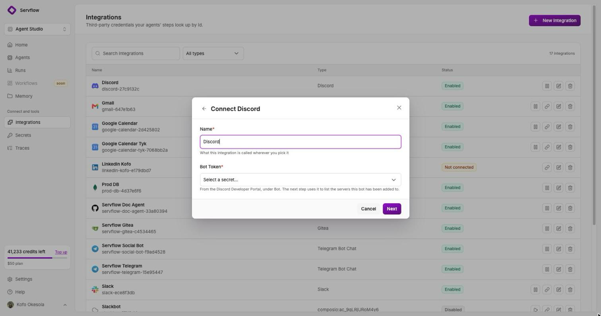
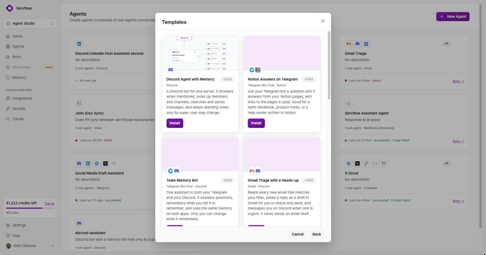
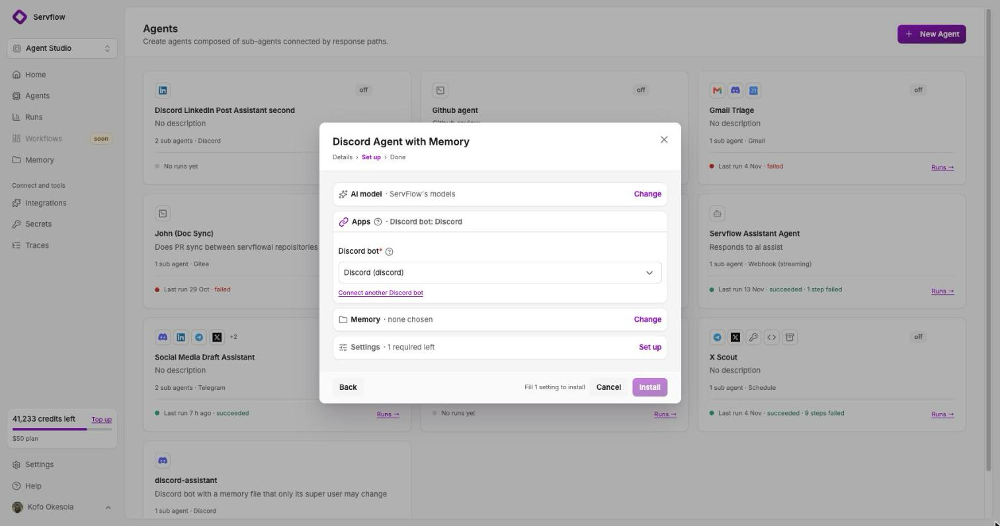
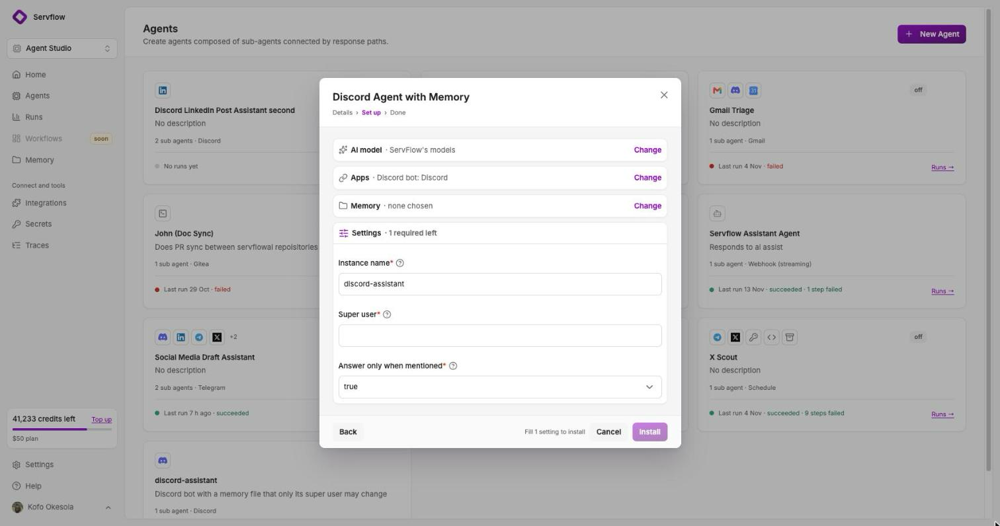

In this tutorial you put an AI helper into a Discord server you own. When someone mentions it, it answers. It can look up members and channels, search and send messages, and keep a notes file that it changes only when you ask.

You start from a ready-made template, so the bot is answering within a few steps. Then you teach it a rule and watch it remember.

## Before you begin

- A Servflow account at [dash.servflow.io](https://dash.servflow.io). Servflow connects out to Discord, so Discord never needs to reach it.
- A Discord account, and a server you own. Create a new server for this tutorial.
- About 25 minutes. Every message the bot answers is a run, which spends your team's credits. See [Plans and credits](/concepts/plans-and-credits).

## Step 1: Create the bot in Discord

This step happens in the [Discord Developer Portal](https://discord.com/developers/applications), not in Servflow.

1. Create an application and give it a name. This is the name your bot has in Discord.
2. Open the application's **Bot** page. Under **Privileged Gateway Intents**, turn on **Message Content**. Without it, the bot connects and is disconnected at once.
3. On the same page, copy the bot's token. Keep it private. Anyone who has it can act as your bot.
4. Open **OAuth2 > URL Generator**. Select the `bot` scope, then the **View Channels**, **Send Messages**, **Send Messages in Threads**, and **Read Message History** permissions.
5. Open the generated URL and add the bot to your server.

The bot appears in your server's member list, offline.

## Step 2: Store the token

1. In the Servflow sidebar under **Connect and tools**, click **Secrets**, then click **New Secret**.
2. Name it `discord-bot-token`, paste the token as its value, and click **Add secret**.

The secret is listed by name. Its value is not shown again.

## Step 3: Connect Discord

1. In the sidebar, click **Integrations**, click **New Integration**, and choose **Discord**.
2. Under **Name**, enter `community-bot`. Under **Bot Token**, choose `discord-bot-token`. Click **Next**.
3. Choose your server and click **Add integration**.
4. In the `community-bot` row's actions, click **Enable integration**.

<Frame>
  
</Frame>

`community-bot` appears in the **Integrations** list with the status **Enabled**. For each screen of this dialog, see [Connect an agent to Discord](/guides/connect-an-agent-to-discord#add-the-discord-integration).

## Step 4: Create a memory

1. In the sidebar, click **Memory**, then click **New memory**.
2. Name it `Community notes` and click **Create memory**.

This is where the bot keeps its notes. Give the bot a memory of its own.

## Step 5: Install the template

1. In the sidebar, click **Agents**, then click **New Agent**.
2. Choose **Use a template**. In **Templates**, on the **Discord Agent with Memory** card, click **Install**. The **Details** step shows the apps it uses, the settings you fill in, and its sub agents. Click **Set up**.

<Frame>
  
</Frame>

3. In the **Set up** step, fill in each group:
   - **AI model**: keep **ServFlow's models** to run on your team's built-in model. You need no provider of your own.
   - **Apps**: under **Discord bot**, choose `community-bot`.
   - **Memory**: under **Understand request**, choose `Community notes`.

<Frame>
  
</Frame>

4. Open **Settings**. Enter `community-mod` as the **Instance name**. Under **Super user**, enter your own Discord username as `@name`. Under **Answer only when mentioned**, keep `true`.

<Frame>
  
</Frame>

5. Click **Install**, then click **Done**.

The template is installed as an agent named `community-mod`, and you can open it like any other agent. It has one sub agent, **Understand request**, with tools for looking up members and channels, searching messages, and sending messages.

## Step 6: Say hello

1. Open the `community-mod` agent. In the top bar, switch **Disabled** to **Enabled**. A message confirms **Agent enabled**. In Discord, the bot now shows as online.
2. In any channel the bot can see, type `@YourBot hello, what can you do?`

The bot replies in the channel.

## Step 7: Give it a rule to remember

1. In Discord, type `@YourBot remember that self-promotion is only allowed in #showcase`. The bot confirms.
2. In Servflow, click **Memory** in the sidebar and open `Community notes`. A file named `memory.md` is in the list. Click it. Your rule is in it.

## Step 8: See what it remembers, and whom it listens to

1. In a different channel, type `@YourBot can I post my project here?` The bot answers from the rule, although the rule was given in another channel.
2. From a second account, or with a friend's help, type `@YourBot forget the self-promotion rule`. The bot should decline. Its instructions tell it to change its notes only for you, the super user.

## What you built

- **An integration** holds your bot's token, and is how the agent receives messages and replies as your bot. See [Integrations](/concepts/integrations).
- **A Discord bot trigger** decides which messages start the agent. Yours answers only when mentioned. See [Triggers](/concepts/entries).
- **Two kinds of memory.** The bot remembers a conversation within one channel on its own. The rule you gave it works in every channel because it is in a file in its memory. See [Memory and files](/concepts/workspaces-and-files).
- **Tools** let the bot look things up and send messages. See [Add a tool to an agent](/guides/add-a-tool).

## Next steps

- Limit the channels the bot answers in, under **Runs when** in the agent's **Entry** panel. See [Connect an agent to Discord](/guides/connect-an-agent-to-discord#set-the-trigger-to-discord).
- Stop anyone but you from making the bot send messages, with a guard on its sending tools: `{{ .discord.is_super_user }}`. See [Guard rails](/concepts/guard-rails).
- Change how the bot talks, in the **System prompt** of **Understand request**.
- Put an agent you built yourself on Discord. See [Connect an agent to Discord](/guides/connect-an-agent-to-discord).

## If the bot stays offline

- **Message Content** is turned off in the Discord Developer Portal. Turn it on, then open the agent and switch it off and on again with the **Enabled** switch.
- The agent is not enabled.
- The token was reset in Discord after you stored it. Replace the value of `discord-bot-token`. Then, on the Integrations page, disable `community-bot` and enable it again, and switch the agent off and on again.
